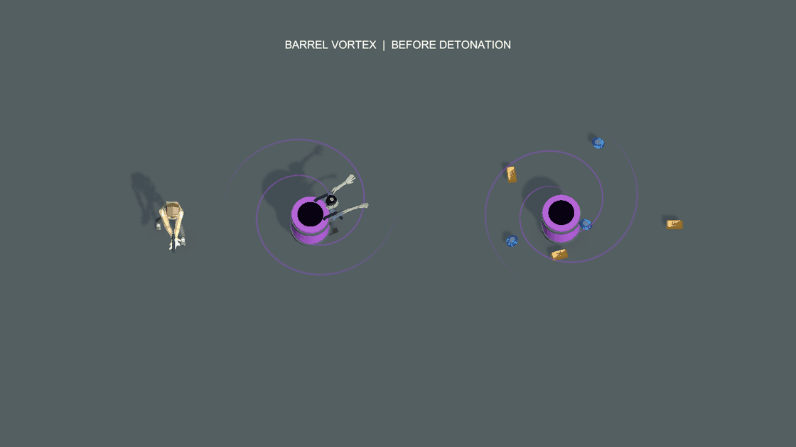

# 漩涡桶爆炸效果预览

2026-10-20。用户追问桶的爆炸效果。本次承接已确认的当前角色／紫桶、小桶大漩涡与浓紫雾预览，补充地面桶爆炸动态。未改正式产品代码或资源，未提交、未打包。

64帧、20fps、3.2秒循环，在0.8秒处引爆右侧地面桶。左侧背桶保持工作作为对照，主角与现有便服丧尸同框。采用72°俯视角，沿用上一版比例。

## 来源与展示顺序

- 主爆炸通过正式 `ArcadeCombatViewController.PlayProjectileBlast` 和当前 `ArcadeObstacleVisualSet.prefab/Content/ProjectileBlast` 实例化与播放；四组正式粒子为 ImpactFlash、Burst、Sparks、Smoke，没有另画火球。
- 爆炸半径从 Barrage 第一轮正式配置读取，本次为3。该参数在爆炸视图中只控制视觉缩放，预览不结算伤害或玩家命数。
- 桶引爆时隐藏桶体和该桶的漩涡／紫雾，停止剩余财宝演示移动；此前吞入的物资不重新生成。
- 爆闪与橙色火焰之后，金属／紫漆碎片散开，烟雾退去。碎片借用当前 `SmallFragments.asset` 网格，材质来自当前桶身与金属箍；临时轨迹及少量紫色余烟只用于外观预览，尚未接入正式桶爆炸生命周期。
- 未添加新的爆炸后持续伤害圈，没有把吸物雾气继续留在已毁桶的位置。

## 画面与验证

[爆炸前](before.png) · [爆闪](flash.png) · [碎片](fragments.png) · [余烟](smoke-fading.png) · [清除后](cleared.png)

实际爆炸池输出4组粒子，记录峰值71，最后采样粒子数0，详见 [explosion-evidence.txt](explosion-evidence.txt)。GIF的64帧、1120×630尺寸及五张关键图已解码检查。没有运行游戏测试或声称完整战斗验收。

拍摄脚本见 [Capture.cs.txt](Capture.cs.txt)，其中包含临时桶片与余烟辅助类。以完整代码模式运行类 `BarrelExplosionPreview` 的 `Run`，只允许本项目编辑态。渲染结束释放临时材质、正式爆炸池实例与附加场景；保留其他原有场景及工作区改动。
