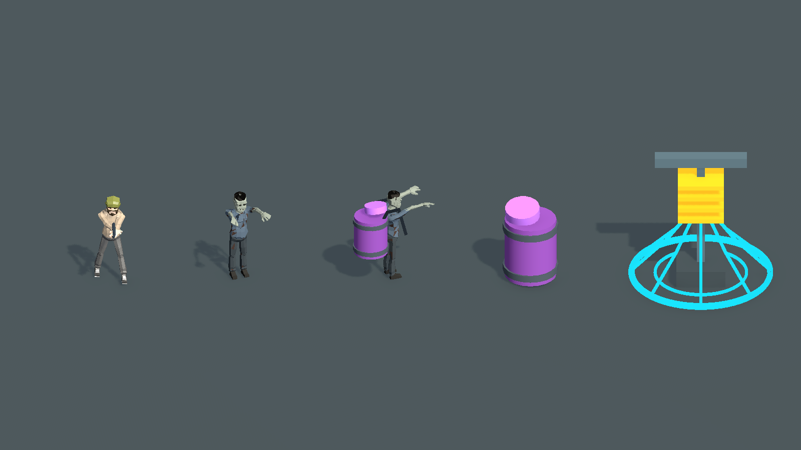
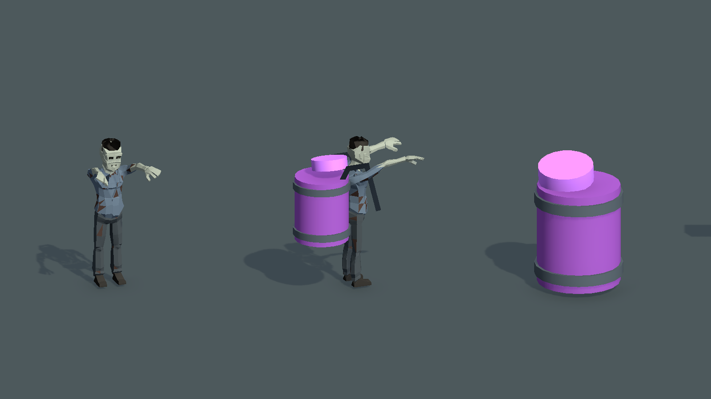

# 当前资源背桶组合预览

2026-10-20。用户指出此前概念没有基于当前正式游戏内容。核查确认此前拿旧版绿皮僵尸截图作为生成参考，而当前正式僵尸已是便服人形丧尸。旧概念撤出制作依据；本目录直接加载当前 Prefab，在 Unity 编辑态临时附加场景拍摄。

## 实际复用内容

- 主角：`Client/Assets/Game/Prefabs/Characters/GrayboxPlayer.prefab`，原有手枪与姿态。
- 普通丧尸与背桶丧尸：同一个 `Client/Assets/Game/Prefabs/Characters/ArcadeZombieShambler.prefab`，直接采样正式 `Civilian|Idle_Attack` 动画，不重绘或修改身体、服装、头脸、骨骼。
- 桶：调用正式 `SetRoundContent` 获得现有紫桶，复制该对象用于背部组合；桶体、金属箍和当前几何烟沿用现有实现。背桶预览缩放为地面桶的0.65倍，临时挂到角色背后；两条背带是预览用折线，尚未制作正式蒙皮与动作绑定。
- 电塔：`ArcadeObstacleVisualSet.prefab` 的 `Content/ElectricTower` 模板，由正式 `SetHazards` 投影安全、预警和通电三态，未重新设计。

## 图片

从左到右：当前主角、当前普通丧尸、复用同一丧尸的背桶组合、当前地面紫桶、当前正式电塔。

[安全相位](existing-assets-safe.png) · [预警相位](existing-assets-warning.png) · [俯视检查](existing-assets-topdown.png)

这是 Unity 临时组合实拍，不是 AI 概念图，也不是已经接入正式游戏的背桶模型。角色尺寸与主角同框，没有放大人体。正式烟仍是现有几何表现，本次未借新概念图夸大已经实现的特效质量。

脚本见 [Capture.cs.txt](Capture.cs.txt)。未改动正式资源或产品代码、未保存场景、未打包；清理后只保留原先无脏状态的 Boot 场景。未运行测试，因为本次只作临时视觉组合并渲染。
