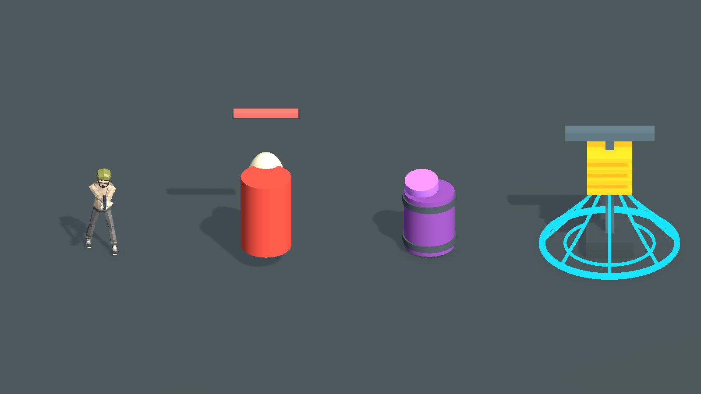
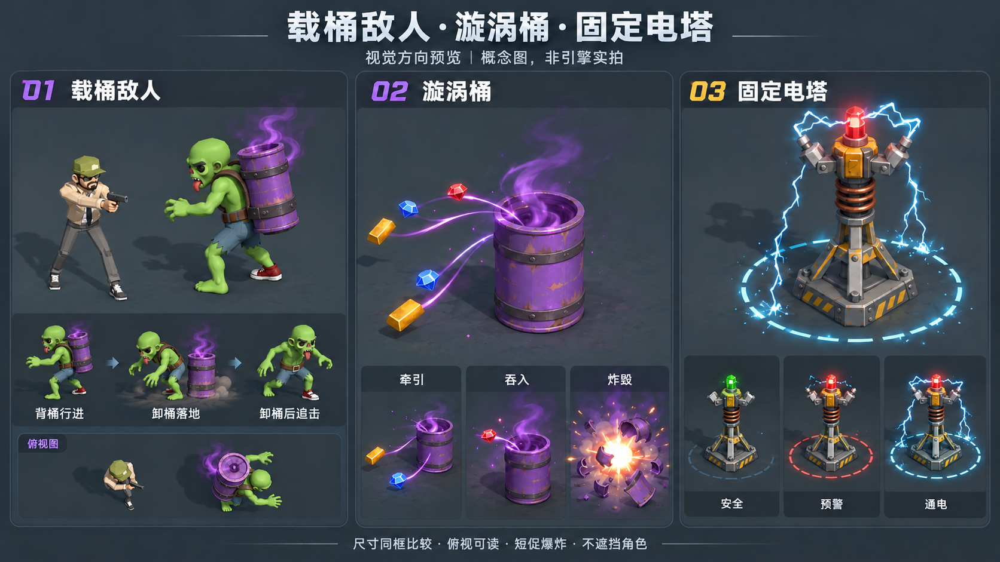

# 载桶敌人、漩涡桶与电塔视觉研究

> 修正：此处 AI 概念误用了 `ZombieRoster-20261019/lineup.png` 中的旧版绿皮卡通僵尸。当前正式 `ArcadeZombieShambler.prefab` 已替换为便服人形丧尸，详见 `Client/Assets/Game/Art/Enemies/Zombies/README.md`。用户指出后，绿皮概念不再作为后续制作依据。已补充[直接复用当前正式资源的 Unity 组合预览](../BarrelTowerExistingAssetPreview-20261020/README.md)，以后者为本次最新预览。

2026-10-20。用户请求研究视觉并提供预览，随后明确修正：桶应背在敌人背上。此目录仅保存研究、正式表现的隔离拍摄和概念图，未替换正式资源、未修改产品行为、未提交或打包。

## 参考证据与范围

已取得 [MKillBill《DOA2》v2.5 敌人与机关正文](https://gamefaqs.gamespot.com/ps4/145061-call-of-duty-black-ops-iii/faqs/72570/enemies-and-hazards)。载桶／漩涡桶段落确认紫色桶、紫烟、物资被吸入；Shock Towers 段落确认绿灯安全、转红将启动。原文配图链接读取受限，本次没有据此声称还原了原作模型细节、贴图、电弧动画或粒子精确时序。

背桶方式以用户在本次对话中的明确要求为设计依据。肩带、腰带、侧后视角、紫色物资拖尾、电塔铜线圈／电极结构及蓝白分叉电弧是本项目美术建议。概念中的物资轨迹为示意，正式逻辑仍沿已实现的直线牵引规则；本次未改变任何轨迹或数值。

## 当前 Unity 实际表现

调用正式 `SetEnemyContent`、`SetRoundContent`、`SetHazards`，加载正式主角 Prefab 和电塔模板。通过临时附加场景、统一相机／地面／比例拍摄；渲染结束销毁临时对象并关闭临时场景，没有保存场景。不把隔离拍摄写成完整实战验收。

从左到右：正式主角、当前载桶简模、当前漩涡桶、正式电塔。

另有 [安全相位](current-safe.png)、[预警相位](current-warning.png)、[俯视检查](current-topdown.png)。拍摄时钟为0、4.1、5.6秒，只采样权威时钟；脚本见 [Capture.cs.txt](Capture.cs.txt)。

现状：载桶简模仍用胶囊体加红色圆柱，缺少正式背负轮廓；漩涡烟为实心圆柱，缺少烟雾透明度和卷动；电塔电弧是固定折线，缺少分叉闪动，灯色与塔体层次仍可加强。正式主角与设施同框，未单独放大角色。

## 推荐方向：背桶版概念

- 载桶角色与正式主角接近身高，紫桶竖直固定在背部，两肩带加腰带，头脸和双手保持可见。背桶行进→从背部卸桶落地→空身追击。紫烟从肩后上升，俯视能辨认背部桶口。
- 落地桶与背桶共用紫色漆面和金属箍，桶口有暗心与薄紫烟；物资靠近时用短拖尾表示吸引，吞入在桶口短促收缩闪光。炸毁使用短白芯、橙色边缘、少量金属碎片和紫烟消散，不残留持续伤害领域。
- 电塔采用钢底座、铜线圈与外露电极；安全绿灯／无弧，预警红闪／少量火花，通电保留红灯并增加蓝白分叉电弧。三态保持同一实际危险半径，细分段边界显示时机，不以扩大光圈暗示扩大判定。
- 细烟和细电弧优先，保留玩家脚下与弹道可见性；不让半透明光效遮住大半角色。

概念图由内置 imagegen 工具生成并根据用户背桶要求定向修订。输入参考为本目录 `current-active.png`（正式主角与设施同框）及 `../ZombieRoster-20261019/lineup.png`（既有普通僵尸造型）。最终提示要求：只修订左栏为背部竖桶、肩带腰带、双手前伸、背后卸桶，并同步所有动作和俯视小图；保留中栏漩涡桶与右栏电塔不变，明确标注“概念图，非引擎实拍”。

此图供外观确认，尚未制作或导入新的正式角色模型／特效资源。正式实现仍需按确认后的外观完成，并在实际俯视镜头验证尺寸、透明叠加和性能。
