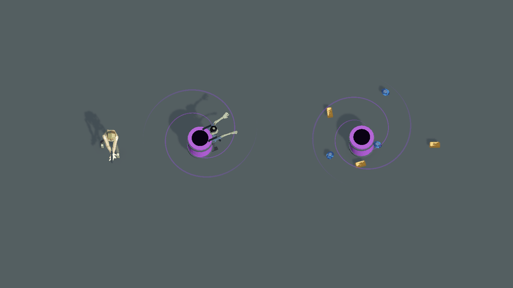

# 俯视大漩涡与浓紫雾预览

2026-10-20。继承用户明确要求：桶背在当前正式便服丧尸背上；桶约半个人高，漩涡约两个人大小，必须有明显紫色雾气。用户随后要求雾气更浓、范围更大。本次仅调整临时预览，没有改动正式模型、配置、战斗判定或提交代码。

48帧、12fps、约4秒循环，Unity隔离场景直接渲染并编码GIF。保留当前正式主角和丧尸、当前紫桶和财宝模型。

## 比例与镜头

- 以当前正式主角可见蒙皮合并包围盒为基准，本次测量高约1.762米；桶体高约0.881米，约为主角一半。背桶与地面桶使用同样桶体比例。
- 漩涡核心展开直径约3.524米，按人高两倍计算。此处明确将用户目测的“两倍大小”解释为漩涡展开直径与人高的比例，不宣称原作已测得精确数值。
- 按后续“雾气范围太小”的意见，将紫雾覆盖直径再扩大约50%；雾团边缘柔化，尺寸为近似视觉范围，不能作为伤害／吸物判定半径。
- 动态主图采用72°俯角，与正式 `PlayerCameraCtrl.ArcadePitchDegrees` 一致，正交镜头方便同框比较。另保存 [正式镜头参数预览](gameplay-lens.png)，使用72°、45°FOV、16米跟随距离；不是完整关卡或正式相机绑定运行。

## 紫雾修改

复用现有 `EnemyFlameSmoke.mat` 和 Smoke 纹理，在临时材质／粒子实例中改成更浓的饱和紫色；150→190个手动采样雾粒子，覆盖范围扩大，并分为四股随时间向内卷动的雾流。紫雾为主要表现，细旋转线仅辅助方向。桶口保留暗心，避免完全遮住吸入位置；中心留空也使背桶角色头部仍可辨认。

财宝靠近、升起、收缩仅为视觉演示，不调用实际拾取或加分；既有权威吸物规则没有修改。预览参数尚未进入产品运行配置。

[静态俯视](vortex-overview.png) · [侧面尺寸对照](ratio-side-comparison.png) · [测量记录](ratios.txt) · [拍摄脚本](Capture.cs.txt)

`purple-spiral-fog.gif` 为最新版本。提交只包含该动画、静态预览、比例记录和拍摄脚本；中间动画及PNG源帧保留在本地，由本目录 `.gitignore` 排除。早期文件被占用导致一次写入失败，随后改在本目录重新完整渲染，没有用混合帧生成最新GIF。

复现时在已连接本项目的 Unity MCP `script_execute` 中以完整代码模式运行 `Capture.cs.txt`，类名 `BarrelVortexDenseFogPreview`、方法名 `Run`；只允许编辑态。输出的48张 `spiral-frame-*.png` 可按12fps编码为GIF，主预览缩放为1120×630。运行前确认场景与工程路径，不能用它启动整局或打包。

渲染后释放临时对象／材质并关闭附加场景，Boot保持无脏状态；未运行产品测试、未打包。
