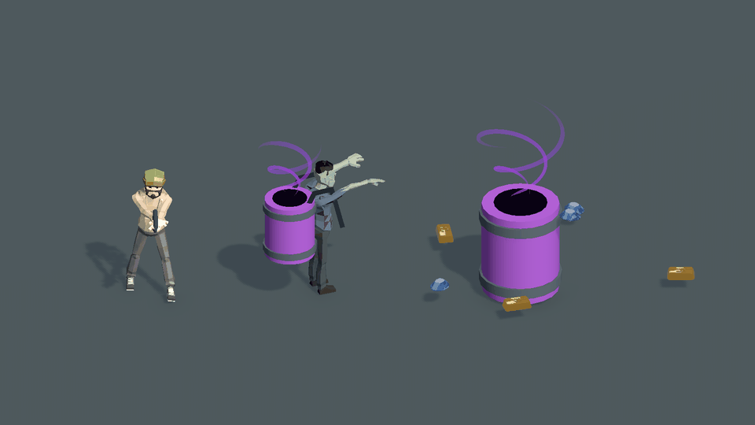

# 桶口漩涡吸物动态预览

2026-10-20。用户指出桶口缺少旋涡吸物表现。本次仅做临时 Unity 动态预览，继续复用当前正式主角、便服丧尸、紫桶，以及 Content 中的 GoldBar／Gem 网格，没有改角色造型或生成 AI 替代图。

48帧、12fps、约4秒循环。由 Unity 手动采样并直接渲染各帧，再编码成GIF；不是正式游戏接入实录。

## 展示内容

- 暂时隐藏原桶上的实心 `VortexSmoke`，桶口增加暗心；上方紫色双股气流旋转收拢，靠近桶口变窄。
- 烟雾复用本项目 `EnemyFlameSmoke.mat` 与其 Smoke 纹理，只在临时材质实例上改紫色，软烟沿漏斗下降；新增气流、材质和对象均只属于临时场景。
- 背桶和地面桶显示同一漏斗，背桶随已有桶体预览缩放。现有主角同框提供比例。
- 财宝使用当前模板网格，预览缩放为模板的0.28倍，靠近桶后升到桶口、缩小消失。升起段保持在桶外，再进入桶口，避免穿过桶壁。
- 当前只是预览采样轨迹；没有调用拾取、加分或删除实际物资，也没有改动现有直线牵引和吞物裁决。若采用，需要另行把表现接入正式权威快照与生命周期。

[静态总览](vortex-overview.png) · [近景](vortex-closeup.png) · [可复现拍摄脚本](Capture.cs.txt)

拍摄完成后销毁临时对象和材质，关闭临时附加场景；Boot保留无脏状态。未修改正式资源、未运行整局或测试、未提交、未打包。
