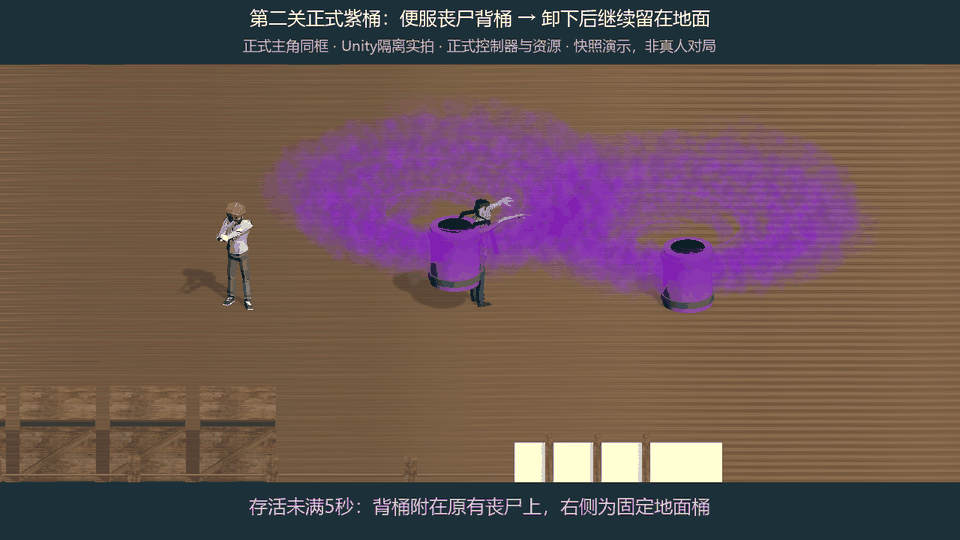

# 第二关紫桶正式接入（2026-10-23）

用户对 `BarrelVortexDenseFogPreview-20261020/purple-spiral-fog.gif` 明确回复“采用这版并正式接入”。沿用便服丧尸、主角半高紫桶、大漩涡浓紫雾，不更换角色尺寸或动作。

2026-10-23比例修正：用户明确“不 这是当前关卡的特色 这种丧尸要占比50%”。第二关四轮SpecialRatio由0.24提升为0.5，现有6/10/10/10预算各3/5/5/5名载桶，替代首轮接入时的1/2/2/2安排。没有新增视觉或变更5秒卸桶/提前击杀紫爆。Config/gen.bat重新双端生成，单双人各3项真实入口检查升级为精确半数断言，旧配置均2/3，修正后均3/3；本次6项全部通过，includePassingTests=true，各上限3。只读独立审查通过，双端bytes SHA256一致。下方38项为首次视觉接入时的历史验证，不冒充本轮重新执行。

这是 Unity 隔离场景使用正式主角、丧尸、码头、紫桶 Prefab 和正式 `SetRoundContent/SetEnemyContent` 入口的快照演示；不是自然对局录像。背桶阶段到第5活动秒移除附属物，原丧尸保留，地面新增卸下桶。时间由录制脚本输入，真实出生与卸桶由以下规则测试验证。源96帧/12fps，编码96帧/7.68秒/960×540，关键帧为 carrying.png 与 released.png；同框实测主角高1.761965米，桶身高0.8809825米。

## 根因与修复

- 第二关实际为配置21，四轮载桶种类为1、比例却为0；每轮只有一个固定桶，无载桶自然卸下新增桶。首次修复恢复0.24，随后按用户明确修正提升到0.5，四轮分别自然出生3/5/5/5名载桶敌人；原6/10/10/10预算保留。
- 正式载桶曾使用胶囊加红圆柱替身。现在借用 EnemyCtrl 当前地图的活动实例，将正式紫桶挂在原丧尸背后，保留其走路/受击/攻击/死亡；卸桶只移除背包，切图先清理外部挂点。
- 固定桶、卸下桶共用已采用浓雾 Prefab。粒子零时间初始化后手动采样权威时钟，暂停和重复快照不推进或复制。
- 环境与Content加载顺序独立；模板晚到时等待下一份快照，实例及采样器完整后才提交记录，失败清理临时根。
- Config权威CSV通过 `Config/gen.bat` 双端生成，未手改代码或bytes。无协议/保存字段变化，无玩家存档读写。

## 定向验证

| 范围 | 结果 | 覆盖 |
| --- | --- | --- |
| EditMode `DockBarrelFlowTests`，maxTests=3 | 3/3 | 真实四轮出生、5秒只卸一次、提前死紫爆 |
| EditMode `DockBarrelVisualTests`，maxTests=7 | 7/7 | 正式资源比例/持久材质/无碰撞、原丧尸保留、重复时钟、固定/动态桶、切图、晚到根/模板 |
| EditMode `ArcadeRoundContentViewTests`，maxTests=7 | 7/7 | 原布局/危险区/地面桶/屋顶落桶回归 |
| EditMode `GroundBarrelFlowTests`，maxTests=18 | 18/18 | 射桶、吸物、结算、清场、Boss、玩家安全、累积卸桶 |
| .NET `DockBarrelOnline`，maxTests=3 | 3/3 | 双人真实权威通道出生、卸桶、克隆/编解码、玩家安全 |

全部 `includePassingTests=true`，共38项最终定向检查通过；不运行完整套件或无效过滤回退。自然出生新增3项曾0/3，正式视觉6项曾0/6，模板晚到新回归曾0/1，修复后通过。独立只读审查发现的模板晚到P1已修复并复审关闭。

没有运行Player Build、资源打包或真人双客户端实战验收。
