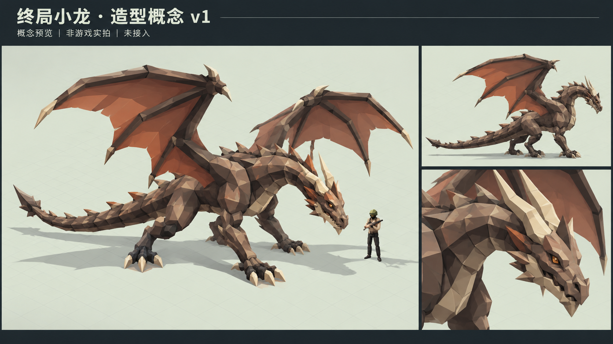

# 终局小龙造型概念 v1

日期：2026-10-26。来源：用户纠正终局 Boss 应参考 LOL 小龙，并要求“那就帮我做好”。

后续状态：用户回复“可以”采用本概念造型，随后启动本工程。连接已恢复，已制作[Unity实际模型与动作候选](../FinalDragonModel-v1-20261026/index.html)。下方连接阻塞与概念待采用描述保留为本图初次交付时的历史；当前以执行总清单及新预览为准，正式接入仍未完成。

本图为 AI 生成概念，非 Unity 实拍、非正式模型，也不是动作预览。参照现有 `TenStageCreatures-v1-20261025/Papaback/static-candidate.png` 的主角与低多边形风格制作；主角在图中的形象是生成的参考，不能代替正式主角原尺寸实例的同框验证。画面提出岩褐色龙身、暖色翼膜、长颈、长尾和角冠；具体造型与尺寸待用户采用。

正式目标是替换终局巨猿的外形方向；保留原有终局玩法，不自行新增攻击、飞行或伤害。原巨猿候选作为历史保留，其他角色候选不受影响。

## 当前阻塞与下一步

本会话没有原生 Unity MCP 工具；通过 `Tools/PickupFeedbackChecks/Invoke-UnityMcp.ps1 -Tool unity-tool-list` 访问本项目配置中的 MCP 服务时，初始化连接被目标计算机拒绝。未修改 MCP 配置或启动另一个工程，未确认实时场景与 Console，未操作 Unity。

待 Unity MCP 恢复后制作隔离临时模型，与正式主角原尺寸同框，并录制可播放动作预览。用户采用具体视觉后才能改正式资源，随后完成必要验证。本次未改 Client、Config、Server 或正式资源，未运行测试、未 Player Build；整个 Boss 制作任务尚未完成。

原始生成图保留于 Codex generated_images，本目录保存项目副本。用户确认入口为执行总清单“终局 Boss 小龙造型修正”。
