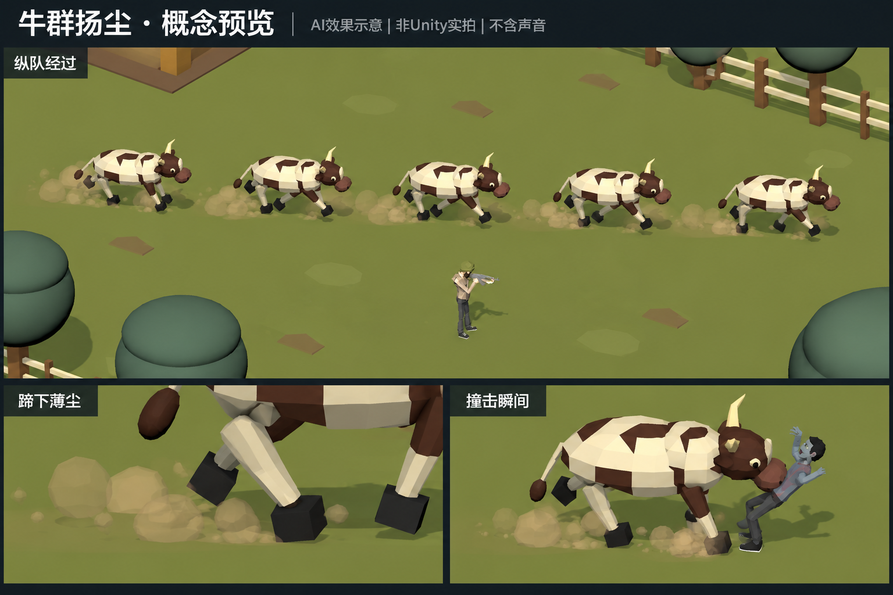

# 牛群扬尘概念预览 v1

采用更新：本静态方向已获“可以”，随后制作Unity有声v1并再次获明确正式采用；最终以[Unity动态与音色](../HerdDust-Unity-v1-20261023/README.md)为准，未把AI重绘模型／地形作为替换要求。

用户在声音与扬尘设计后要求“你发我预览图”，本次仅交付静态概念图。使用内置imagegen生成，非Unity实拍、不含声音、未接入正式资源；不是动态表现、音色或精确尺寸的验收证据。具体方案和画面均待采用，制作预览的要求不代表正式接入获批。

图中依正式参考呈现五牛前后纵队、主角体量参照、蹄下浅土褐色薄尘及撞击尘团；重点供判断尘量、颜色和遮挡程度。AI对模型／环境的重绘不构成替换正式资产的要求，实际角色尺寸仍以正式Prefab为准。独立玩家击飞落点修正不在此图授权范围。

参考输入：

- FarmGroundApplied-20261023/candidate-player-scale.png：主要配色、正式牛及主角比例参照。
- HerdSingleFile-20261023/herd-single-file.png：仅参考五牛前后纵队，不采用历史积雪。
- HerdImpactApplied-20261023/herd-impact-applied.png：仅参考正式牛及目标设计，不更改现有击飞规则。

## 生成提示词

Create ONE landscape game VFX CONCEPT PREVIEW BOARD for FirepowerLoop. This is an illustrative proposal, not a real Unity capture. Reference 1 is the PRIMARY style, cow design, exact cow-to-player scale, olive grass ground, muted farm palette and lighting reference. Reference 2 ONLY shows the required five-cow SINGLE FILE formation, one behind another, all facing the SAME direction; ignore its old snowy terrain and all text. Reference 3 is ONLY another reference for the same formal cow and human designs, not an instruction to change knockback. Preserve the recognisable chunky faceted cream-and-brown horned cattle (dark brown round muzzle, cream horns, black hooves) and the SMALL formal human rifleman with olive helmet, beige shirt, dark pants. Do not upscale the human relative to the cow. Make a clean readable 1536x1024-style board: a slim dark header with clear Chinese title '牛群扬尘 · 概念预览' and subtitle 'AI效果示意｜非Unity实拍｜不含声音'. One LARGE upper main panel (~65% of board height), orthographic elevated gameplay camera, five existing-design cows running from LEFT TO RIGHT IN ONE HORIZONTAL SINGLE FILE, not side-by-side and not a crowd, with clear gaps between cows and heads facing right. Keep all five fully in frame. A formal rifleman is standing safely below the lane in this SAME panel for a truthful scale comparison. Ground is muted olive grass with sparse brown patches, a little existing simple farm wall/tree/fence along distant edges only. Focus on proposed low-density light SOIL BROWN DUST puffs from landing hooves, staying below lower legs, lingering in short discontinuous trails behind each cow. Dust consists of soft translucent slightly faceted puffs, no glowing particles; ground and black hooves remain clearly visible. No opaque smoke blankets, no snow, no fire, no speed beams, no big cartoon impact stars, no HUD arrows or ground warning markings. Label main panel '纵队经过'. Bottom third: TWO side-by-side close-up panels, left label '蹄下薄尘' showing one hoof touchdown with several small transparent tan dust puffs, right label '撞击瞬间' showing the SAME cow contacting an existing-design dark grey zombie, with one SMALL dense but brief-looking SOIL dust puff near the low contact/foot level; no blood, explosions, pose redesign or changed cow size. Subtle clean dividers, no excessive annotations, keep a screenshot-like low-poly Unity material aesthetic rather than painterly illustration. Avoid changing terrain layout, redesigning cow or hero, adding cattle in rows. This board should let the user assess DUST DENSITY AND COLOR, and clearly differentiate AI concept from formal game footage.
