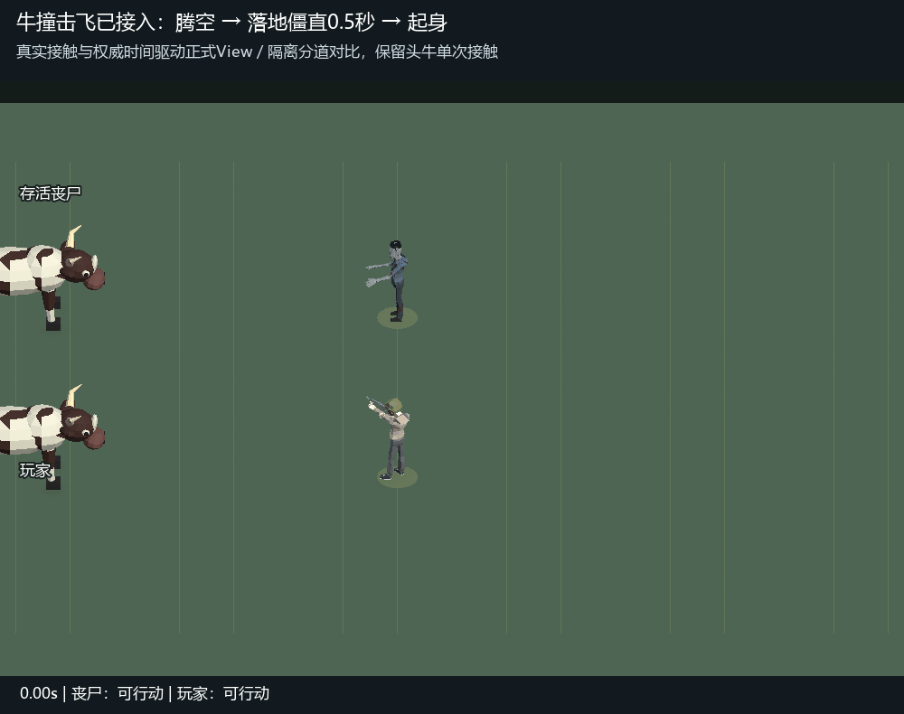

# 第三关牛撞击飞接入记录

2026-10-23。用户对v2动作预览回复“可以”，授权正式接入。玩家和存活丧尸被撞后前飞3米，明显腾空约2.5米，飞行0.95活动秒；落地保持倒姿0.5活动秒，再用0.25秒起身。途中击杀沿当前轨迹落地并保持死亡。墙体及场地边界仍限制水平位移。

这是**正式碰撞与权威活动步驱动正式View的隔离录制**，不是自然通关或真人双端实拍。使用正式牛、主角和丧尸模型；为了同框比较，在临时预览场景中将两个受击目标分道显示，并只保留已生成五牛中的头牛，记录单次接触。正式关卡仍为五牛前后纵队、间距3米、速度7.15米/秒（玩家基础6.5），未修改场景或美术资源。

`Tools/Unity/HerdImpactAppliedCapture.cs`调用真实单人测试fixture与`TickRoundContent`，同步记录权威位置和剩余阶段；正式PlayerView/EnemyView消费同一状态。`encode-herd-impact-applied.py`验证100帧、20fps、5秒；[活动轨迹](authority-trace.csv)验证两者无遮挡时均前飞3米，落地后连续10帧保持位置，即0.5秒。截图核对腾空高于牛背，落地倒姿无累积偏移。

验证范围与证据：

| 范围 | 结果 | 原始记录 |
| --- | --- | --- |
| 单人实际接触、禁用操作、保护、清场完成落地、新地图复位 | 5/5 | [authority.json](authority.json) |
| 正式模型、死亡衔接、暂停尸体与回收、复位 | 5/5 | [visual.json](visual.json) |
| 当前阶段快照复制、停止移动预测、既有身份投影 | 4/4 | [network.json](network.json) |
| 原有纵队、慢速、保护、扫掠、尾牛离场与切图 | 10/10 | [herd-regression.json](herd-regression.json) |
| 双人服务器权威、行动限制、快照克隆与MemoryPack、死亡及存活敌人 | 13/13 | [server.txt](server.txt) |
| 原有尸体淡出回收、预热物理反馈分配 | 2/2，分别限定完整方法 | [corpse-regression.json](corpse-regression.json)、[allocation-regression.json](allocation-regression.json) |

Unity检查均为明确的真实EditMode类或完整方法，`includePassingTests=true`，最大数量分别5、5、4、10、1、1；服务器限定`testClass=HerdOnline includePassingTests=true maxTests=13`。未运行完整套件或Player Build。

新增单人行为检查曾5项失败；新增死亡/暂停边界检查曾2项失败，修复后上述范围全部通过。独立只读审查的两处P2（空中死亡重飞、联机暂停仍推进尸体）已修复并复审，无未解决发现。协议由`Tools/gen-protocol.ps1`生成双端，未手改生成文件。

联机验证覆盖真实服务端规则与序列化和客户端投影；未宣称真人双端操作手感验收。提交仅包括本任务改动，共享文件按本任务片段收录。

最终Unity查询为本工程、编辑态、Boot未脏；Console有1条MCP并发测试忙拒绝（该范围随后重试通过），无本次编译或游戏异常，详见[状态](unity-state.json)和[日志](unity-console.json)。共享编辑器期间的忙拒绝未扩大测试过滤范围。
