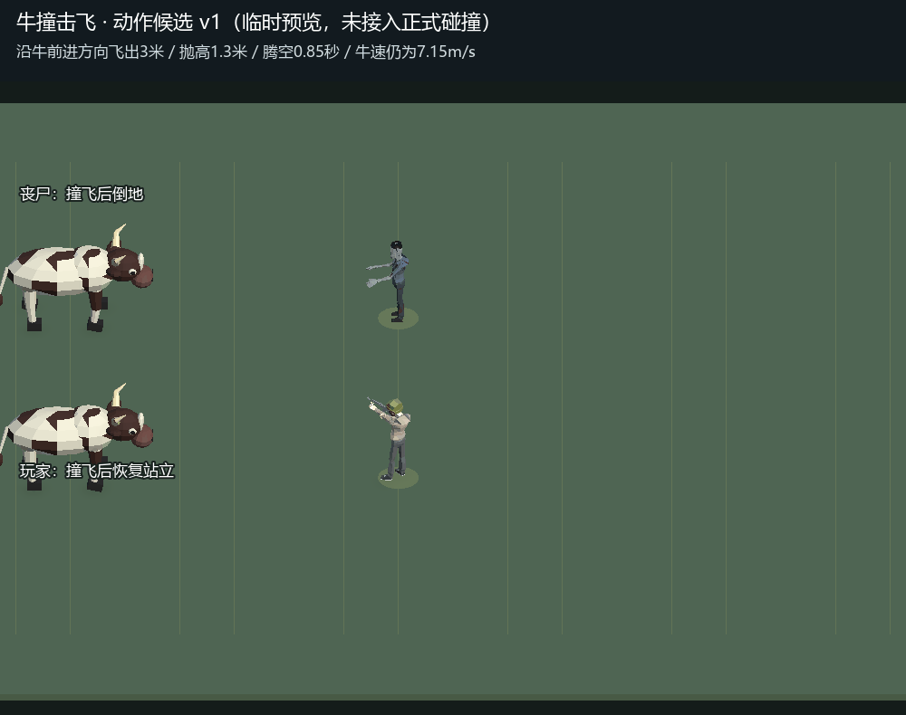

# 牛撞击飞动作候选 v1

来源：2026-10-23用户要求“牛群打到丧尸要有击飞的效果 玩家也是”。

这是独立Unity预览场景中的正式模型克隆，位移、抛物线及倾斜是临时候选采样，尚未接入正式碰撞、战斗权威或联机。没有修改Prefab、伤害、牛速或正式资源；没有Player Build。

- 牛保持7.15m/s，左右排列只用于同屏对比两类受击者，正式游戏仍为已确认前后纵队。
- 丧尸与玩家沿牛行进方向飞出3米，抛升1.3米，腾空0.85秒。
- 上方丧尸演示击杀后的倒地；下方玩家演示存活落地后恢复站立。
- 原速20fps、72帧、3.6秒循环，GIF编码检查帧数与总时长。
- 待确认：该具体动作与力度。确认后才接入正式单双人规则与表现，不能将此候选记成实现完成。

