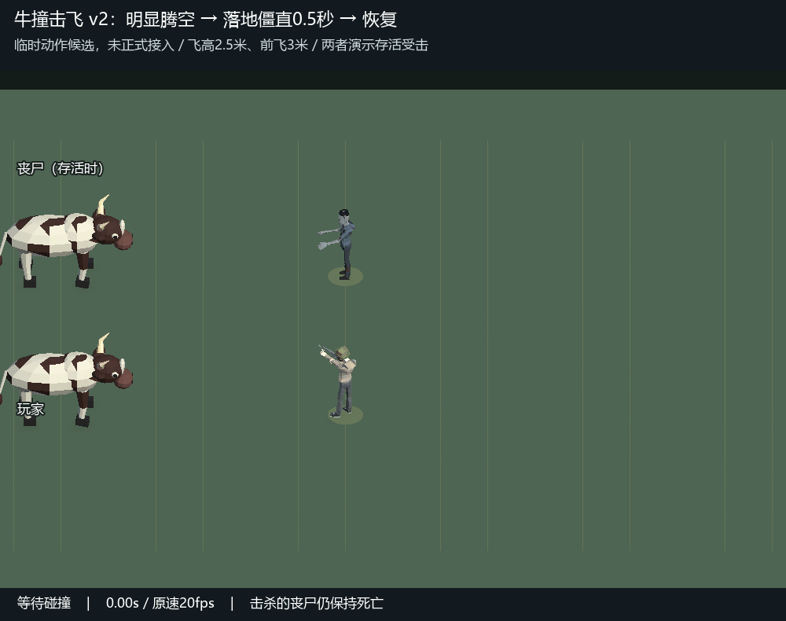

# 牛撞击飞动作候选 v2

来源：用户在v1后明确修正“要飞起来 掉地下僵直0.5s”。

这是独立Unity预览场景中的正式牛、丧尸、主角模型克隆，动作由临时变换采样演示，尚未接入正式碰撞或伤害。两者都演示存活受击；现有正式伤害如果击杀丧尸，仍保持死亡，不会因僵直结束复活。

- 明显腾空：前飞3米、抛升2.5米、飞行0.95秒；牛仍为7.15m/s。
- 落地停顿：落地后完整趴住0.50秒，然后用0.25秒演示起身。
- 时间轴：0.65秒受击，1.60秒落地，1.60～2.10秒僵直，2.10秒开始起身。
- 20fps原速、80帧、4秒循环；编码器核对帧数与总时长，落地僵直区间10帧即0.50秒。
- 临时并列两条通道只为同屏展示玩家与丧尸；正式牛队依然是已确认的前后纵队。
- 没有修改正式Prefab、配置或运行时代码，没有Player Build。具体v2动作等待用户采用。

