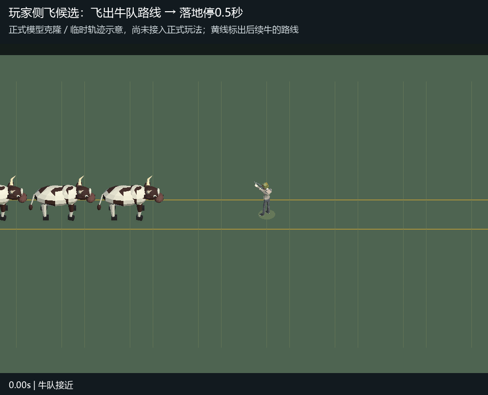

# 玩家被牛撞后侧飞候选 v3

2026-10-23，用户在v2正式击飞交付后要求：“为了避免被后续牛群连续撞击导致无法停下来 还是把玩家撞到其他地方去吧”。本候选替代玩家沿牛行进方向飞出的落点；丧尸的既有动作继续保留。

建议玩家被撞后斜向牛队侧边飞出3米，其中前移1.2米、侧移约2.75米，离开后续牛的冲撞路线；明显腾空2.5米、飞行0.95秒，落地僵直0.5秒，再用0.25秒起身。正式接入时应选择场内可落脚的一侧，沿用原有地图阻挡及伤害保护。

这是正式主角和正式牛模型克隆的**隔离临时轨迹示意**，不是正式碰撞、伤害或真人操作验证。每组仅一个主角、完整五头牛前后单列，间距3米、速度7.15米/秒；黄线为临时示意标记，不是新增游戏界面或场景资源。正式运行时、Prefabs、场景与配置均未修改。

`Tools/Unity/HerdImpactSidePreview.cs`产生100帧隔离画面，`encode-herd-impact-side-preview.py`确认GIF为20fps、5秒，落地停顿10帧即0.5秒。已核对腾空、侧移落点及后续牛经过画面。上述检查只验证候选录制，不能代替正式双端连续接触回归。

采用记录：用户在本会话查看本GIF和“斜向飞到牛队侧边，侧移约2.75米，落地仍僵直0.5秒，让后续牛从旁边经过”后回复“可以”。具体动态及正式开工均已确认；取代本候选原待采用状态。正式接入与当前验证见[交付记录](../HerdImpactSideApplied-20261023/README.md)。
