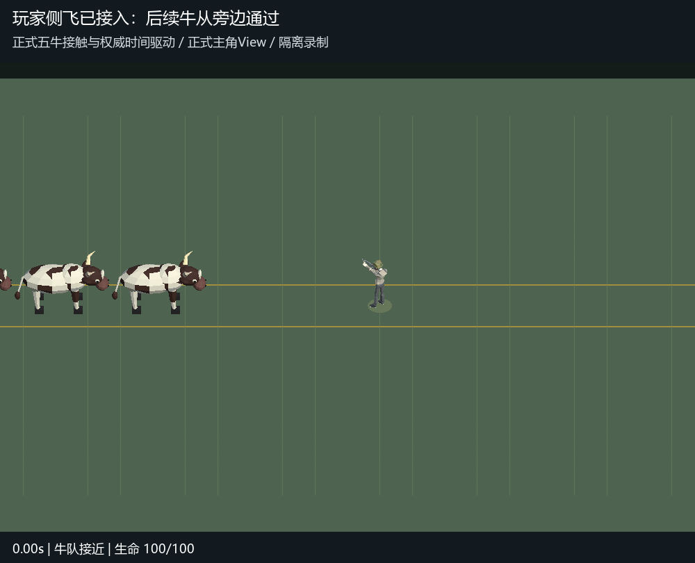

# 玩家侧飞正式接入记录

2026-10-23，用户要求避免后续牛连续撞击，并对[侧飞v3动态](../HerdImpactSide-v3-20261023/README.md)回复“可以”。本次正式接入玩家斜侧飞：无遮挡时总行程3米，前移1.2米、侧移约2.75米，飞行0.95活动秒、落地僵直0.5活动秒、起身0.25秒。丧尸继续沿牛的方向飞行。

单人和服务器分别通过各自已有的短步地图碰撞，预估两个候选落点到牛道的距离，选择更能离开通路的一侧；两侧等距时朝场内。方向只在受撞时锁定，之后由权威活动步逐帧推进。保留五牛前后纵队、间距3米、7.15速度、原有伤害与保护、地图障碍及边界，未新增免伤规则或改变资源尺寸。

这是**真实完整五牛接触与权威状态驱动正式PlayerView的隔离录制**，不是自然通关或真人双端手感验收。录制以正式模型同框显示五牛和主角；地面线仅为隔离说明。临时测试主动清除接触保护，以证明后牛落空来自玩家实际侧移，正式保护规则未修改。

`Tools/Unity/HerdImpactSideAppliedCapture.cs`调用真实农场测试fixture与`TickRoundContent`，保留全部五牛和逐帧生命；[权威轨迹](authority-trace.csv)由编码脚本验证：100帧、20fps、5秒；前移1.2米、侧移约2.75米；落地连续10帧保持位置；生命100→75，此后后四牛通过仍为75，击飞状态最终解除。已查看腾空与落地画面。

验证已通过的范围：

| 范围 | 数量 | 证据 |
| --- | --- | --- |
| 完整五牛、左右行进、偏心接触、合法场边通道、单侧障碍、恢复操作 | 7/7 | [side-contact.json](side-contact.json) |
| 侧飞距离、落地0.5秒、禁用操作、保护、清场完成落地、切图复位、存活敌人 | 5/5 | [authority.json](authority.json) |
| 模型复位、死亡延续、联机暂停尸体与回收 | 5/5 | [visual.json](visual.json) |
| 快照复制及客户端移动预测 | 4/4 | [network.json](network.json) |
| 原有队形、速度、保护、清场、地图切换与死亡边界 | 10/10 | [existing-herd.json](existing-herd.json) |
| 双人权威全部既有牛队检查、两成员后牛连续经过、边缘选向、侧飞快照克隆与MemoryPack | 15/15 | [server.txt](server.txt) |

客户端限定真实EditMode类，`includePassingTests=true`，上表最大数量分别7、5、5、4、10；服务器限定`testClass=HerdOnline includePassingTests=true maxTests=15`。共46项通过（客户端31、服务端15）。共享编辑器其他任务的测试类型错误修正后，额外10项回归已通过；[最终编辑器状态](unity-state.json)为正确项目、编辑态、未编译、Boot未脏、Console错误0／警告17。

RED记录中，中心及偏心接触均能复现后牛再次伤害；加入侧向落点后通过。场边测试的起点已改为正式通道x=2.2，避免将玩家放入x=0的既有隔墙内。独立只读审查未发现阻止提交的问题。协议沿用已存在的X/Z方向字段，不需要修改或生成协议；本次也不改Config、Prefab或场景。未运行完整测试套件或Player Build。
