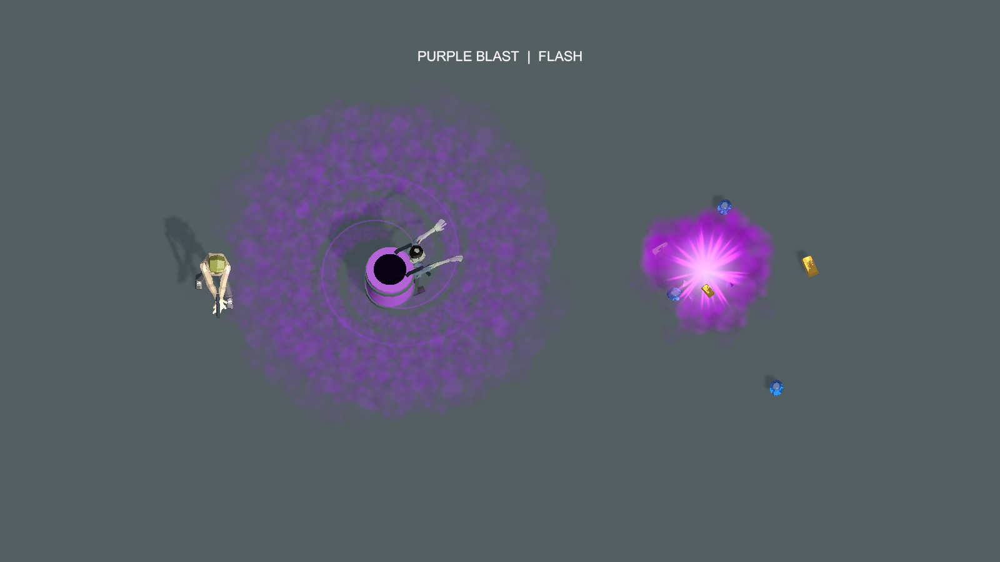
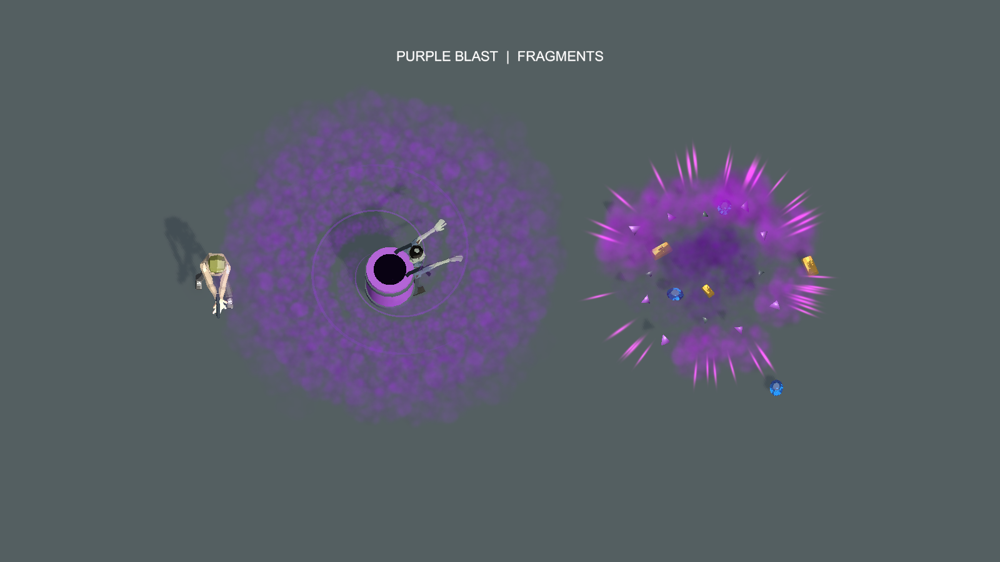

# 紫色桶爆炸与声音候选预览

后续状态：用户已确认紫色主预览 A；正式接入结果与带声采样见 [正式资源预览](../FormalPurpleBarrelPreview-20261020/README.md)。下文保留候选阶段记录。

2026-10-20。用户指出此前橙色爆炸配色没有先确认，而且没有声音预览。旧橙色演示不作为桶专属效果的定稿；本次给出紫色候选和现有音效试听，只作临时预览，不接入正式产品或替换资源。

## 带声预览

- [A：紫色爆炸＋现有能量爆炸音](purple-explosion-energy.mp4)
- [B：相同画面＋现有普通爆炸音](purple-explosion-ordinary.mp4)

视频4.2秒、20fps、1120×630，0.8秒处引爆，声音同步开始。A／B画面一致，音效供用户试听选择，不预设其已经批准。

可单独试听 [能量爆炸音](ArcadeExplosionSciFi.wav)／[普通爆炸音](ArcadeExplosion.wav)。两个WAV均逐字节复制自当前 `Client/Assets/Game/Audio/Sound`，没有生成新音效、变调或替换正式文件。能量音源长3秒，普通音源长2.043秒；视频保留完整尾音。GIF无声音，故此次使用MP4包含音轨。

## 紫色候选画面

沿用当前正式主角、便服丧尸、紫桶及已预览的大漩涡、浓紫雾；主爆炸仍基于现有 `PlayProjectileBlast` 的四组粒子。只在临时实例上替换中性的既有 Smoke／BlastGlow 材质并改粒子颜色，避免原橙色Fire贴图干扰紫色。候选表现为紫白闪芯、紫色扩散粒子、紫色碎片与紫雾尾烟。正式Prefab、材质和普通投射物爆炸均未改动。

碎片和紫色余烟依旧是临时演示轨迹，不是完整战斗接入。没有改变伤害、吸物范围、音频路由、限频或联机协议。

## 验证与复现

- [拍摄代码](Capture.cs.txt)：Unity MCP完整代码模式运行 `PurpleBarrelAVPreview.Run`；仅本项目编辑态、临时附加场景。
- [视频配音脚本](encode_preview.py)：输出两个音轨候选，音频延迟800毫秒，与第16帧引爆同步。工具依赖只安装在被忽略的 `Client/Temp/BarrelAVTools`，未引入项目依赖。
- [音视频验证](audio-video-verification.txt)：两段视频及声音完整解码，前0.7秒静音、引爆后音频非空，原WAV和拷贝哈希一致。
- 原粒子池调用记录见 [explosion-evidence.txt](explosion-evidence.txt)；配色为本次临时候选，不冒充现有正式紫色桶爆炸。

拍摄结束清理临时材质、爆炸实例与附加场景，未保存正式场景。未运行产品测试、未提交、未打包。必须在用户确认紫色画面与音效后，才作为正式桶专属效果的制作依据。
