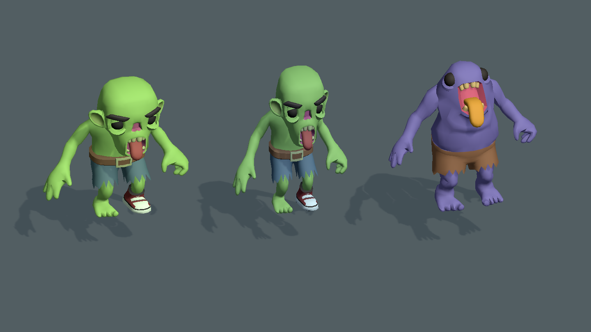
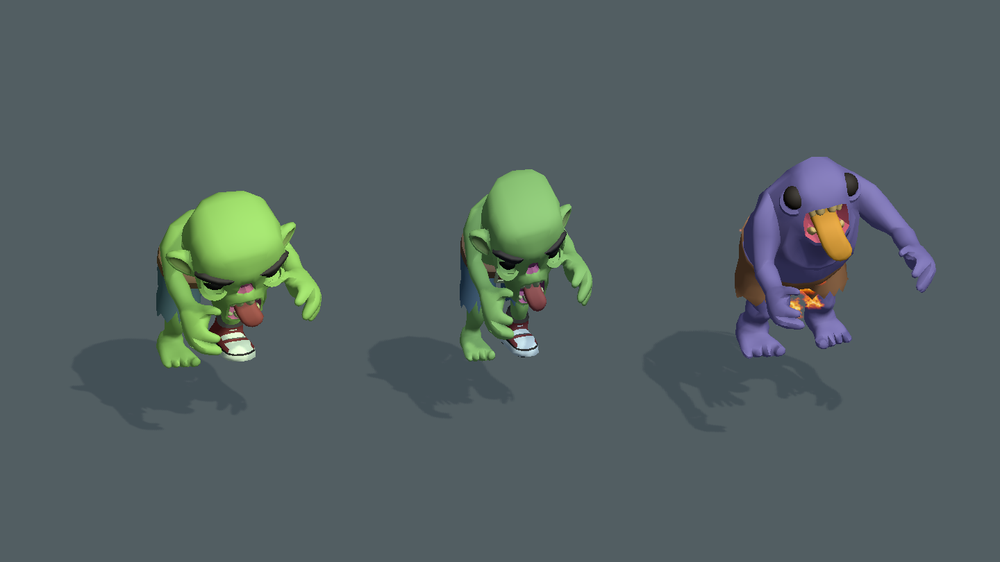

# 前期空手僵尸接入验证

2026-10-19，Unity MCP 确认工程 E:/GitHub/FirepowerLoop/Client，编辑态 Boot。未执行 Player Build 或资源打包。

前 3 场使用独立僵尸敌群与新预制体：普通、瘦型、胖型；首岛维持单一普通僵尸。第 4 场及之后的持械敌人和旧资源保留。新敌群沿用原数量、间隔、存活上限与倍率；原弓手槽改为空手近战，不再发射弹丸。空手敌人允许不配置必掉武器。

来源及授权见 Client/Assets/Game/Art/Enemies/Zombies/README.md 与 Source/License.txt。

## 定向检查：68 项通过

| 范围 | 最大数量 | 实际通过 |
| --- | ---: | ---: |
| ArcadeZombieRosterTests | 7 | 7 |
| EnemyPhysicalReactionTests | 30 | 24 |
| ArcadeEnemyFlameTests | 7 | 7 |
| ArcadeOpeningFlowTests | 30 | 24 |
| Game.Tests.ArcadeOpeningTests.IslandFourWaves_UseOnlySlowBasicEnemiesAndFullSoloTotals | 1 | 1 |
| IslandEnemyChaseOnline | 5 | 5 |

所有检查均使用非空类名或完整方法名，includePassingTests=true。未运行完整测试套件。新僵尸真实抓击状态与骨骼变化、眼睑/舌头/身体同时显示、普通及爆炸死亡、脚骨层级复用还原和火焰清理均覆盖。

ArcadeOpeningFlowTests 原夹具缺少切图表现端口，导致两项宝藏返回流程空引用；补内存 TransitionView，保持黑幕未遮挡，仅验证规则队列，避免加载场景与存档事务。24 项随后全部通过。

Config/gen.bat 双端生成成功，tbenemy/tbarcadearena/tbarcadeenemygroup/tbarcadeweapon/tbarcaderule 的客户端与服务端 bytes 逐字节相同。新增 3 个独立 YooAsset 收集项。只读代码复核无重要阻断问题。

## 引擎实际资源预览

使用 Tools/Unity/ArcadeZombiePreview.cs 在隔离场景拍摄，未修改正式场景。

