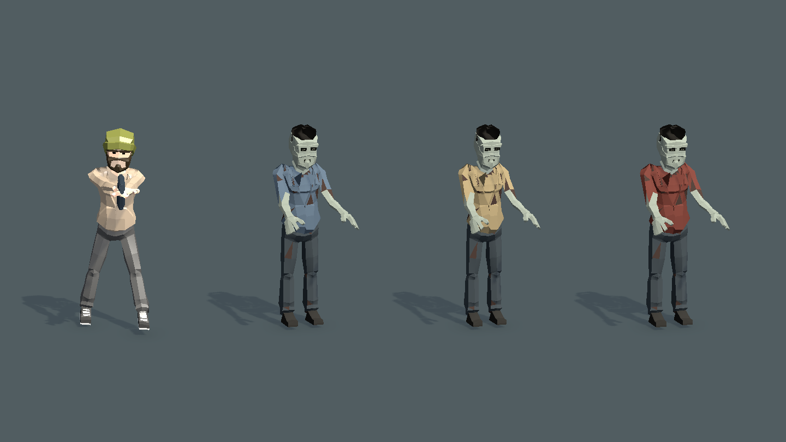
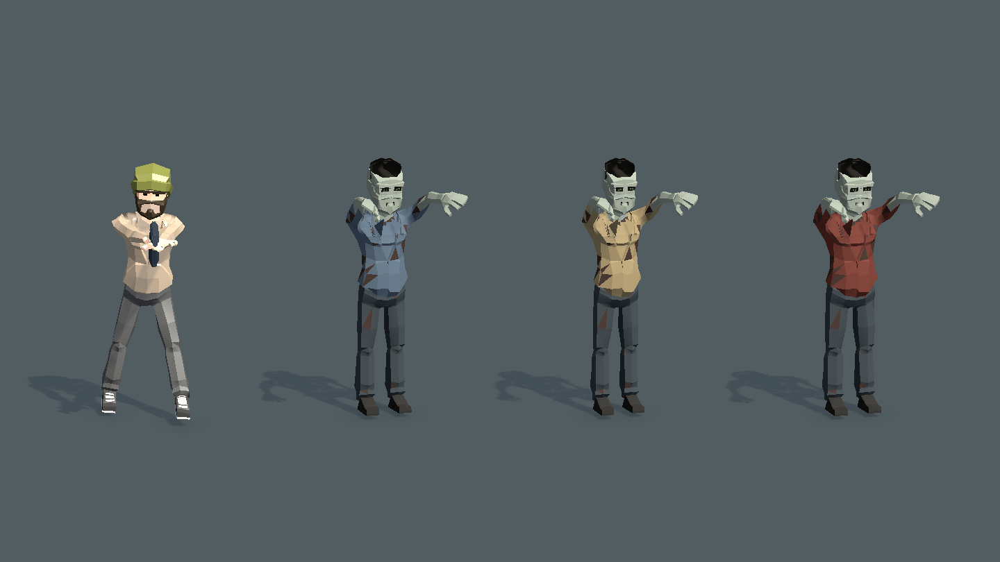
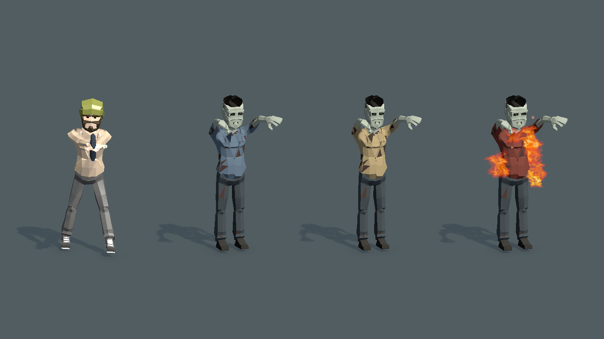

# 人形便服丧尸验证

用户确认概念预览后，将前期三个正式丧尸替换为人形感染者：蓝灰、米黄、暗红便服，灰白皮肤、短发、空手抓击。高度按正式主角默认身体蒙皮顶点对齐，约 1.666 米；三种头部本体宽度约为主角的 96%、87%、100%。原后期持械敌人、既有数值和配置不在本次改动范围。

## 正式资源预览

以下为 Unity 隔离场景内正式 Prefab 拍摄，左侧为正式主角；共用地面、距离、相机，不是概念图，也不是实际对局截图。

## 验证记录

Unity MCP 确认连接路径 `E:/GitHub/FirepowerLoop/Client/Assets`，编辑态 Boot 场景。只执行以下限定 EditMode 类，`includePassingTests=true`，声明上限 47 项；实际返回 41 条执行结果，全部通过。工具 Summary 的 TotalTests 为工程发现数量，不能当成本次执行数量。

| 测试类 | 实际通过 | 覆盖 |
| --- | ---: | --- |
| ArcadeCivilianZombieTests | 3 | 三种真实蒙皮身高、头部本体宽度、脚底落地、物理接线、火焰躯干位置 |
| ArcadeZombieRosterTests | 7 | 前期空手配置、后期持械保留、抓击骨骼运动、脚骨与死亡复用 |
| ArcadeEnemyFlameTests | 7 | 受火、击杀火星余烟、附着、回池清理 |
| EnemyPhysicalReactionTests | 24 | 死亡物理接管、爆炸、冻结、复用与分配 |

先前尺寸测试把主角帽子计入头宽，已按实测网格改为比较 Body_Head。附着火焰测试先复现三种模型偏离腹部约 0.461 米，再将制作工具的火焰局部位置归零，三种均通过。最终检查 Console 最近两分钟无 Error。

制作工具已重复执行并成功保存，沿用正式 Prefab、控制器 GUID。原卡通 Source 与材质保留；新人体网格、脸、短发、翻领、材质与动画独立保存。未触发 Player Build 或资源打包，未改玩家存档。

独立只读审查未发现重要问题。预览检查覆盖站姿、扑抓和受火；未将隔离预览宣称为完整战斗实机验收。
