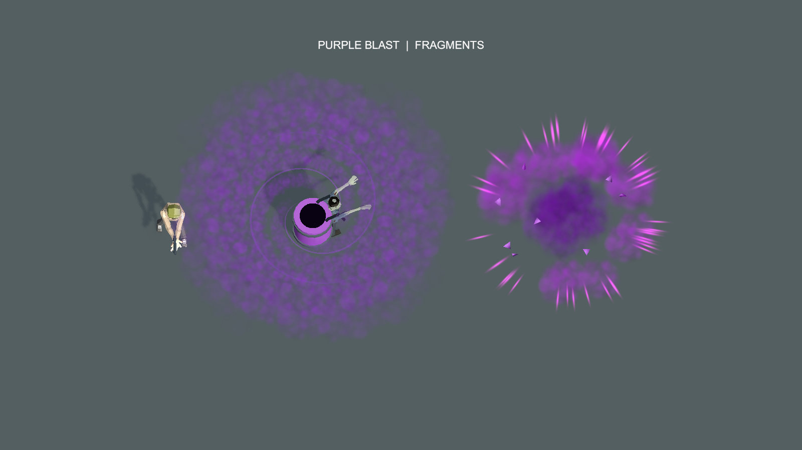

# 正式紫色桶爆炸资源预览

用户确认紫色候选与主预览 A 后，将紫色爆闪、扩散、碎片与余烟接入正式 `VortexBarrelBlast.prefab`，使用既有 `ArcadeExplosionSciFi.wav`。

[带声音的视频](purple-explosion-energy.mp4)为正式粒子 Prefab 在 Unity 隔离场景中的实拍采样，4.2 秒、20fps，0.8 秒处通过权威 Kind14 快照触发。音轨在编码时配入原始能量音效，与引爆同步；不是游戏音频设备的实时录音。

爆炸六层粒子全部来自正式资源，没有临时改色或额外模拟碎片。采样峰值125粒子，结束为0；检查爆闪、扩散碎片、尾烟和消散帧。视频周围的背桶、大漩涡和浓雾沿用此前临时方案，仅作比例参照，本次正式接入范围为桶爆炸画面与声音。

复现：Unity MCP完整代码模式执行 [Capture.cs.txt](Capture.cs.txt) 中 `FormalPurpleBarrelPreview.Run`，再运行 [encode_preview.py](encode_preview.py)。程序只开临时附加场景并清理，不保存正式场景。[采样记录](explosion-evidence.txt)、[音视频检查](audio-video-verification.txt)。

声音来自当前项目既有文件，拷贝哈希一致；验证视频与音轨完整解码、0.7秒前静音、0.8秒后存在声音。

接入和定向测试范围见 [正式接入验证](../../紫色桶爆炸正式接入验证-20261021.md)。
