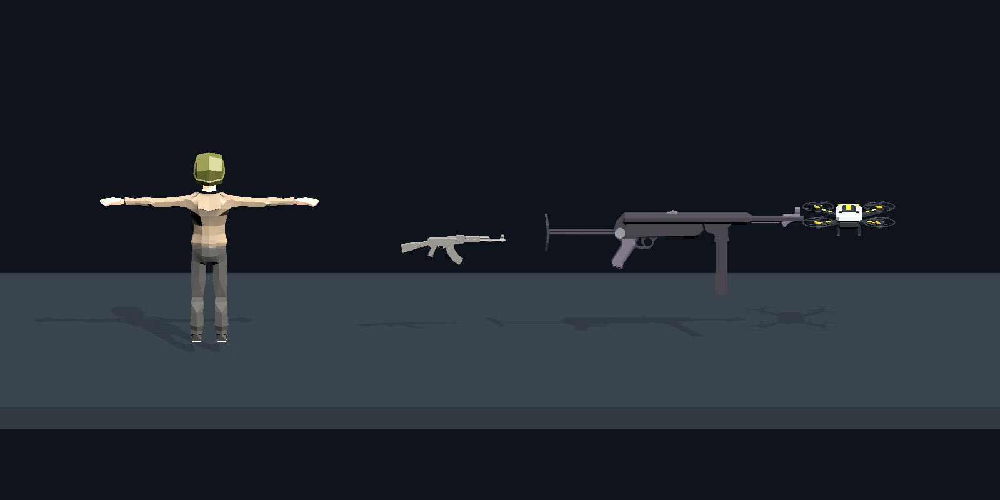

# 前三关方案确认汇总（2026-10-22）

状态：用户已于2026-10-22确认此前全部玩法要求及下列三项选择，并补充无人机强化与到期行为。本文件覆盖旧方案中的冲突表述，不是已实施或已验收记录。按本文顺序组织制作；尚未展示的新增视觉须先提供独立预览并获得确认，再修改正式资源。

## 已明确的要求

### 海岛四轮与地图边界

- 第一关海岛也必须补完整，“第一场保持现有内容”已经被用户的新要求替代。
- 四轮使用四张手工制作的固定地图，不随机生成地图、障碍或通道位置。
- 风格统一为海边、树林、丘陵；各图海陆比例和通道表现可以不同，不要求全部只有一面海。
- 三面林地山坡、三条平路和一面海岸是已有布局参考；各轮可以变化，例如用停船、码头表现敌人下船入场。轮船是用户举例，具体四图方案仍需预览。
- 山地、密林、礁石与海面向镜头外延伸，填满外围可见区域，不能露出山后空地或地图边缘，让玩家误以为能绕过去。
- 不可通行的地方用看得见的实体地形或障碍阻挡；空气墙仅用于敌人进出通道及离场通道的边界。
- 敌人从明确通道外进入，不能在场内凭空出现。

### 刷怪与过关

- 分时段刷怪，每段只从一个通道生成新敌人，各段方向随机选择；固定地图不代表固定刷怪顺序。
- 10秒、20秒是用户举例，尚未冻结具体时长。不增加来敌方向提示或切换预警。
- 不额外规定禁止连续随机到同一通道；该限制此前由助手提出，用户未明确要求，不能作为已确认规则。
- 已入场敌人继续追击；换通道不让旧敌人消失。
- 同一关内部：清完当前轮，玩家走到开放的通道进入下一轮，不另弹过关确认。
- 关与关之间：整关打完才在地图中部指定位置出现传送门。海岛完成第4轮后进传送门到第二关码头。
- 传送门不是每轮出现。此前助手“每轮都传送、通道只进怪”的解释作废。

### 基础武器、首关投放与强化

- 基础武器从手枪改为步枪，采用下方已确认的现有AK外形候选；正式持枪效果仍需预览确认。
- 首关额外武器／支援只投放喷火器与无人机，不投放连射枪或散弹枪；金币、红紫骷髅不因此取消。
- 所有空投武器均为限时使用，到期恢复基础武器；这是现有空投枪械已有规则，不是仅为无人机新增限制。无人机也限时，作为跟随自动攻击的支援，不替换手持武器。
- 玩家获得红／紫强化时，无人机同步获得相应强化；强化结束时恢复对应的当前状态，不把无人机强化独立延长。
- 无人机临近到期时，攻击范围内有敌人才冲向敌人，自毁并造成爆炸伤害；没有敌人则正常到期消失，不空炸。冲撞和爆炸仅发生一次，不增加来敌提示或额外名称HUD。具体持续时间、临近到期窗口和伤害按项目调参，不冒充原作数据。
- 金币、红紫骷髅的敌人击杀掉率按敌人强度提高，不直接按关卡编号提高。弱敌掉率低，紫骷髅比红骷髅更稀有，避免前期持续强火力过于简单。
- 具体概率、分段时长和战斗数值为后续实施调参项，不要求用户研究配置细节，也不得标为原作精确参数。
- 先前纳入范围的同枪普通→红→紫、紫级移速及后期火箭三联追踪／射线反射触电／榴弹快速连发继续保留；未定的细节先形成明确方案，不擅加弹道能力。

### 地面掉落与每轮金币宝箱

- 地面物品比实际手持／生效模型更大，以接近玩家体量、容易辨认为目标；拾取后恢复正常手持或跟随尺寸。
- 所有地面掉落物不显示具体名称HUD，像金币一样靠模型、外形和颜色辨认。已拾取的武器／强化状态继续在原玩家状态栏展示。
- 武器投放箱缩小，开盖后不能遮住武器；不恢复武器名称HUD。
- 每轮清场后掉一个金币宝箱，海岛四轮各一个。
- 宝箱落地自动爆开，金币与金块散落地面；开箱及散落特效全部结束后，才允许拾取。
- 不因播放宝箱特效额外冻结玩家移动。允许主动离场，未拾取物品放弃，不强制全收集或自动代领。

### 其余范围

- 第二关为码头，包含载桶敌人、漩涡桶和电塔；第三关为雪地农场，含牛群，第11轮后插入竞速，再回第12轮。先前设计的既有范围继续保留，不自动追加新功能。
- 保留单人、既有双人、本局强化与40轮主线，不开发基地、远征或局外成长。
- HUD、便服丧尸、喷火器、桶与电塔已有实现主要做新场景接入和回归，不能重复记为全新制作。
- 发布准备和Android后台下载列后续；不打包、部署或平台提交，不恢复已移除脚步声。

## 用户已确认的三项选择

1. **基础步枪候选**：采用现有ArcadeRifle.fbx的AK外形；现役同名ArcadeRifle.prefab实际使用MP40冲锋枪，不能混称。下图为现有资源临时陈列，尚非正式持枪效果。
2. **无人机用法**：拾取后作为临时支援，跟随玩家自动攻击，不替换手持武器；与所有空投武器一样限时，不改成整局常驻。追加的强化与到期冲撞规则见上文。
3. **未捡完奖励是否可以离场**：允许主动离场，未领取物品放弃，不增加全收集门禁或自动代领。

从左到右为正式主角比例参考、AK外形步枪源模型、现役MP40、现有无人机。AK源模型仅按约0.9米候选长度摆放，其余为Prefab实例；不是正式装备截图，也不表示手部挂点、动画或最终比例已确认。

## 还需提供预览再确认的视觉项目

- 四张海岛的完整外围、通道与各轮变化；码头、农场和竞速场地的具体布局。
- 基础步枪持枪效果；放大掉落物与缩小武器箱的同镜头效果；无人机地面及生效尺寸。
- 每轮宝箱落地、爆开、金币／金块散落的完整动画，以及整关结束传送门的外观与出现效果。
- 无人机普通／红／紫作战、临近到期冲撞与爆炸，以及无目标正常消失的可播放预览。
- 牛群、车辆及新增紫级专属弹道等尚未确认的造型和动态效果。

这些预览由制作方准备，不要求用户读代码或研究技术方案。原已确认的正式视觉不重复审批；新增或改变的视觉逐项以实际预览为准。口头确认玩法不代替尚未展示的视觉确认。

## 统一制作顺序

1. 复核当前基线与阻塞；以本汇总替代旧计划中海岛不改、来敌提示及每轮传送门等冲突描述。
2. 先做四张固定海岛、通道与外围，以及基础步枪、放大掉落物／缩小箱子的独立预览；补齐宝箱、无人机和传送门可播放预览，逐项确认具体视觉。
3. 完成海岛四轮、分段随机通道刷怪、内部通道过轮和整关传送门；接入已确认的基础步枪及首关喷火器／无人机投放池。
4. 完成按敌人强度的金币与红紫骷髅掉率、每轮金币宝箱及拾取时机；完成无人机限时攻击、同步强化和临期有目标冲撞自爆。
5. 按已确认预览制作第二关码头、第三关农场及竞速返回闭环，复用桶、电塔及现有音画；新局路线1→21→22→5，保留旧主题与40轮主线。
6. 完成已纳入的同枪升级、紫级移速及后期专属武器差异；新增弹道视觉仍先预览。无人机强化依赖同一玩家强化状态，避免两套规则分叉。
7. 按实际修改范围做单人／双人、暂停、死亡、到期、切轮、切关和恢复验证；更新实际完成记录，验证无未解决问题后中文提交并推送。发布准备继续排后续，不打包。

上述为统一先后顺序；预览可先备齐，不能用排期代替视觉确认，也不承诺所有制作在一晚完成。

## 本轮实际操作范围

本轮仅核对已有文档、资源临时预览和运行时规则并整理计划。已查到空投枪械拾取后设置剩余时间、战斗中倒计时及到期恢复基础武器的单人／服务端逻辑；无人机新增行为尚未实施。没有改正式关卡、Prefab、运行时代码、配置或掉落数值，没有运行游戏测试。预览作者文件仍属于独立临时素材。
