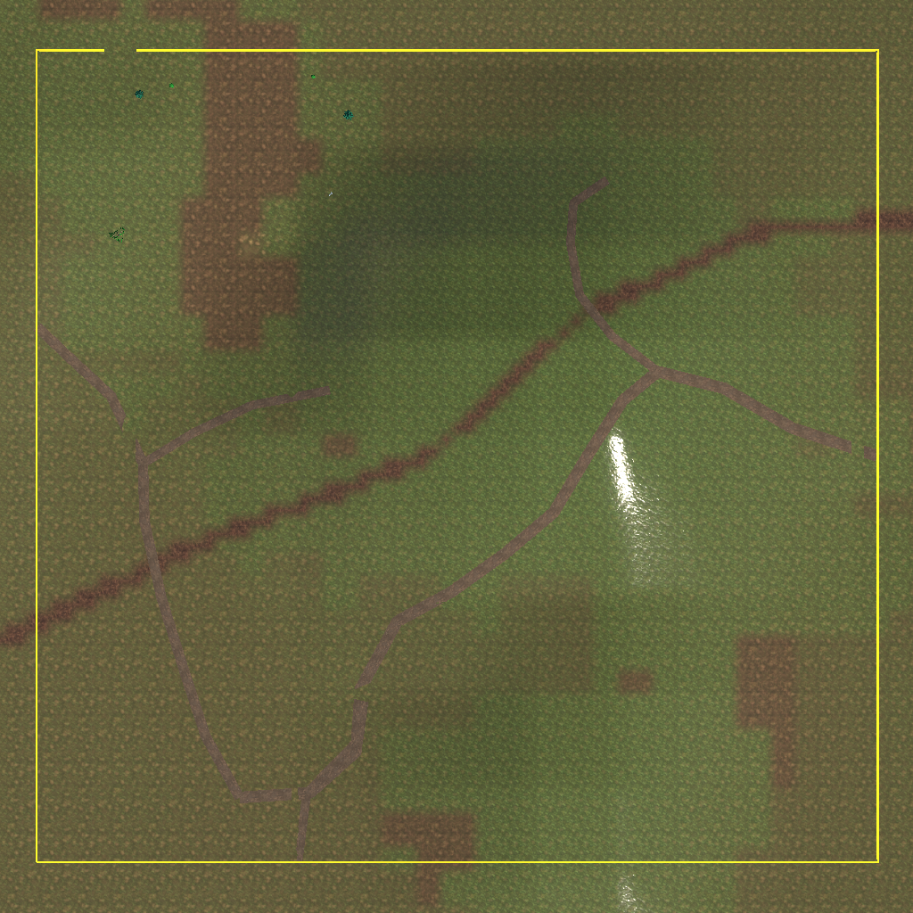
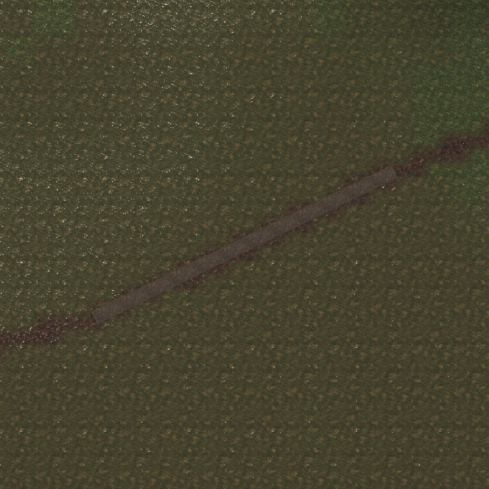
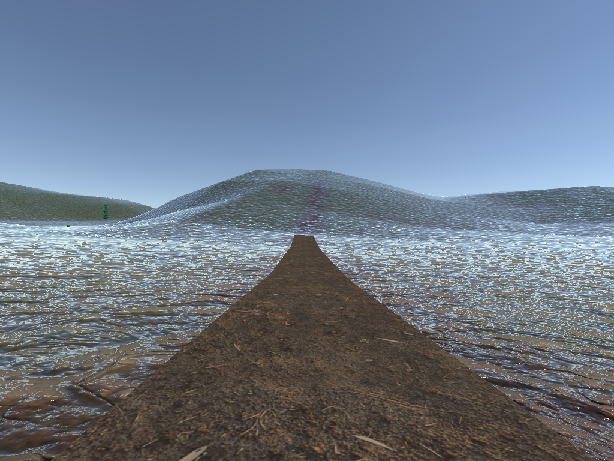
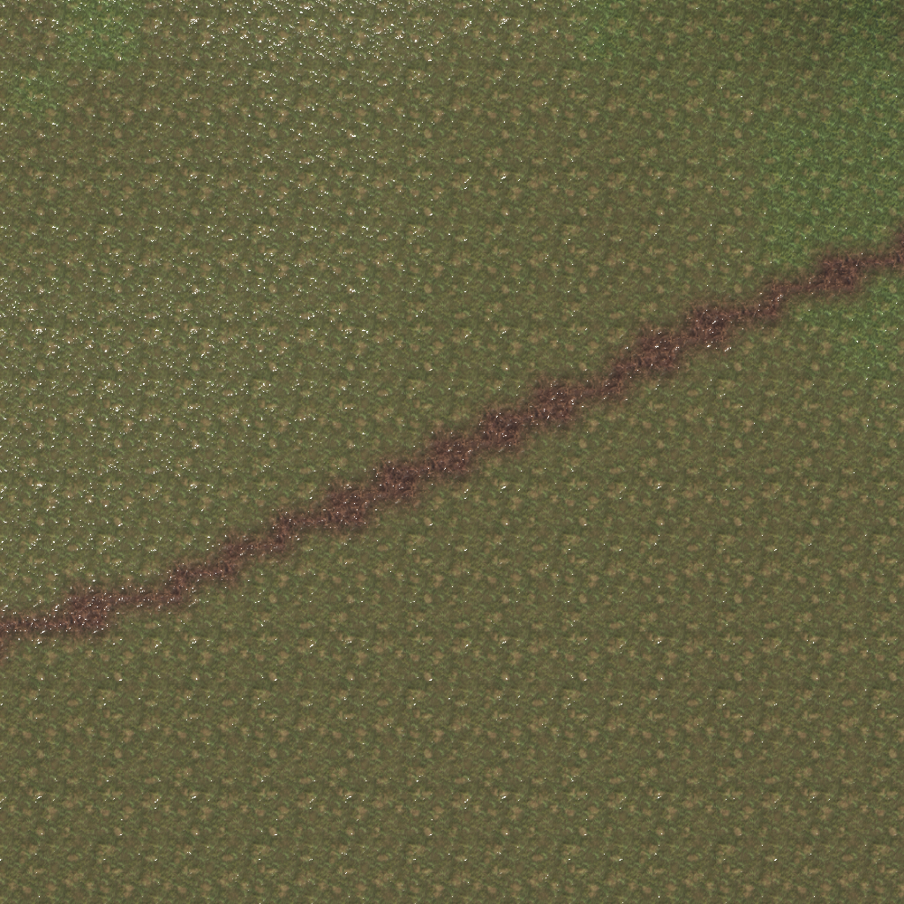
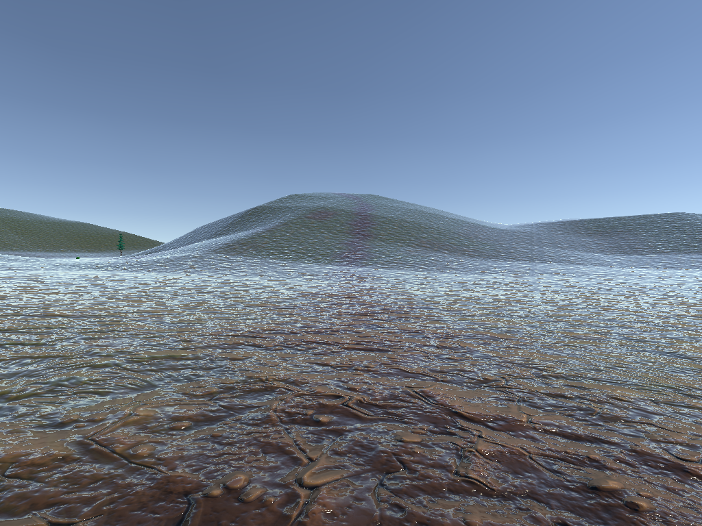
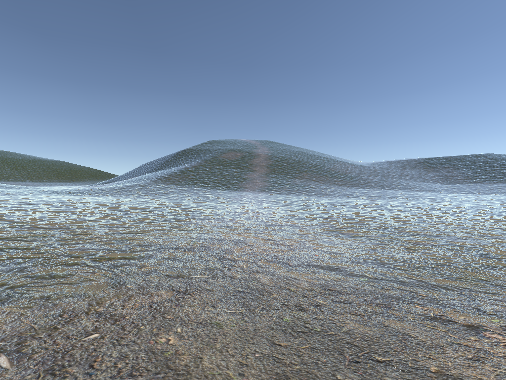

# 和家村 `1_1` 道路样板检查

> 2026-09-26，先记录阶段 B 的原始现状，再增加一段可替换道路样板。2026-09-27 旧单段样板已停用，改由用户在高德卫星图中选定的[当前视野粗布局](和家村1_1当前视野粗布局-20260927.md)继续验证。Terrain 高度与道路来源数据未修改。

## 当前采用的粗布局（2026-09-27）

用户最终选定的高德卫星视野已经落到 `HandAuthoredContentRoot/CurrentViewCoarseLayoutRoot`：约 `286m × 276m`，包含 5 条贴地道路带和黄色范围边界。误加的 7 个橙色建筑占位已清除；和家村不制作建筑。没有修改 Terrain，也没有增加 Collider、NavMesh 或运行时配置。旧 `RoadSampleRoot` 保持停用，避免后续继续依据旧段落判断。

## 历史首段道路样板（已停用）

按 `southwest_connector` 的 `(752,381) → (666,339)` 中心线，已在 `1_1` 的 `HandAuthoredContentRoot/RoadSampleRoot` 保存一段独立贴地网格。长度约 95.7 米，临时路面宽 4 米；网格约每 0.5 米沿线采样，横向分 8 格，离 Terrain 约 0.12 米以减少穿插。没有改 Terrain 高度，也没有增加碰撞体；当前可走地面仍由 TerrainCollider 提供。

颜色和法线使用本地备用库 Ground036 的项目自有副本，保存在 `Client/Assets/Game/Art/Environment/HeJiaVillage/RoadSample/`，因此场景不直接依赖 `Assets/Art` 原包。路宽、贴图、网格均是可替换样板，不能解释为实测道路尺寸。

这两张图采用下文同一俯视与地面视角。现阶段仅供检查整体方向和路面颜色；草地高光、远处陡坡及样板两端的衔接尚未处理。其余道路和池塘没有新增场景占位物。

## 可用于首段验证的路段

`southwest_connector` 中 Unity `(752,381) → (666,339)` 约 95.7 米，距争议池塘 `pond_southwest_03` 较远。沿线 Terrain 地表泥土层已达到权重 `1.0`；横向抽查显示泥土路带约数米宽，但边缘随 256 × 256 的 alphamap 像素变化，不能反推实测路宽。

Unity MCP 从 `HeJiaVillage_1_1.asset` 按约 2 米间隔采样：本段高度约 `16.7 → 17.8m`，最大局部纵坡约 `6%`；以中心线左右各 2 米的高度差估算，最大局部横坡约 `8%`。这些值只描述当前 Terrain，不证明现实路面坡度，也不代替角色碰撞和实际通行测试。

俯视相机固定在 `(709,160,360)`，朝下、北朝上，正交半高 `70m`，输出 `1024 × 1024`。泥土带与草地之间有明显颜色分界，连续性可见；没有独立道路 Mesh。

地面相机位于 `(690, Terrain 高度 + 1.7m, 351)`，朝 `(745, Terrain 高度 + 1.7m, 377)`，视角 `70°`，输出 `1024 × 768`。截图只使用编辑器里 `Boot` 场景已有的方向光。近景纹理反光强且重复感明显；画面前方接入下一段陡坡。因此这张图只能作为现状证据，不能作为写实效果验收图。

### 本地材质候选试拍

本地备用库 `Assets/Art/Julhiecio TPS Controller/Textures/CC0 Textures/Ground 2/` 的 `Ground036_1K_Color/Normal` 看起来比当前裂纹泥地更接近普通土路。此图使用复制到内存的 TerrainData 与临时 TerrainLayer，在同一相机和光照下拍摄；正式地形及共享资源未改。候选减少了夸张裂纹，但整张画面仍有明显高光和纹理重复，且尚无当地路面材质的直接照片。它目前只是可替换候选，不是已采用资源。

Unity MCP 核对四块 Terrain 共用和家村的四个 TerrainLayer。2026-09-27 固定视角 A/B 试验确认道路材质不是大面积发白主因：默认天空反射强度 `1.0` 才是主要来源，Terrain 法线只会放大碎亮纹。正式参数采用地图反射强度 `0.5`，四个 TerrainLayer 统一使用 `normalScale=0.15`、`smoothness=0`，由 `MapSkyboxView` 在地图启停周期接管并恢复反射强度，避免影响其它地图。

## 紧邻路段的阻碍

| 中心线段（Unity `x,z`） | 长度 | 当前 Terrain 的最大约 2 米局部纵坡 | 最大约 4 米横向坡度 | 处理 |
| --- | ---: | ---: | ---: | --- |
| `(1024,494) → (950,491)` | 74.1m | 14% | 12% | 留待坡面与瓦片边界复核 |
| `(950,491) → (885,461)` | 71.6m | 42% | 24% | 不能直接当作普通可行车/步行路面 |
| `(885,461) → (833,412)` | 71.4m | 32% | 21% | 核实道路是否沿山绕行、切坡或底图错位 |
| `(833,412) → (752,381)` | 86.7m | 38% | 11% | 暂不按现有中心线铺设最终道路 |
| `(752,381) → (666,339)` | 95.7m | 6% | 8% | 首段几何与视觉验证候选 |
| `(666,339) → (585,317)` | 83.9m | 9% | 14% | 2026-09-27 高德卫星复核未见历史标注池塘，转为下一段安全候选 |

原始高程是 Copernicus GLO-30 DSM，经重采样形成 Terrain；道路中心线来自高德普通地图目视核对。两者分辨率和时间不同。陡坡可能来自真实地形、DSM 对植被/建筑的响应、道路描线误差或局部工程路基；现有资料不能裁决。阶段 B 不应直接把整条红线压成平路，也不应把 6 米显示符号宽度当作路宽。

## 下一项可执行工作

1. 先由俯视图确认当前粗布局的道路连接是否可继续；若位置不对，只改 JSON 与粗布局，不进入精修。
2. 粗布局确认后，再裁决陡坡段的绕坡/切填关系，并分别确定路宽和路肩。
3. 最后才增加碰撞并用项目角色检查连续通行、上下坡表现；当前粗布局本身明确不承担通行验收。
