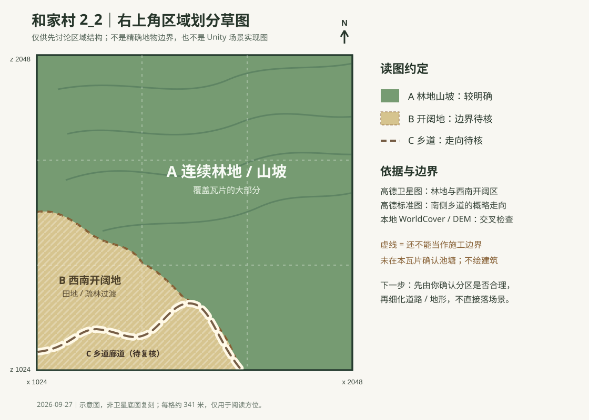

# 和家村右上角 `2_2` 区域划分草图

> **适用范围提醒（2026-09-27）：** 本文针对整张 `2_2` 瓦片，不是用户后来确认的新场景可见矩形；不要将下图用于该新场景。新范围以[用户确认的高德卫星视野](和家村新场景选定视野参考-20260927.md)为准，且须先给用户草图确认。

## 范围与用途

- 对象是整张东北角 `HeJiaVillage_2_2` 瓦片，Unity 范围 `x=1024–2048`、`z=1024–2048`，约 `1024 × 1024 m`。北在上、东在右。
- 这是供讨论的粗分区，不是已测绘的土地利用边界、道路中心线或 Unity 场景修改方案。当前**没有改动任何地形、道路、植被或场景物件**。
- 先分区、经确认再细化；不放建筑，也不以方块代替房屋。

## 初步分区

| 标记 | 区域 | 观察依据 | 当前把握 |
| --- | --- | --- | --- |
| A | 连续林地 / 山坡，占瓦片大部 | 高德卫星图大面积连续树冠；本地 WorldCover 林地参考图交叉支持；DEM 仅支持起伏地形判断 | 类型较明确，内部疏密和脊沟未细分 |
| B | 西南边缘开阔地，可能为田地、疏林混合过渡 | 高德卫星图西南角出现较浅色、破碎的开阔斑块 | 过渡边界只画示意虚线，地类仍需高倍率核对 |
| C | 南侧乡道 / 通行廊道 | 高德标准地图在南缘显示曲折乡道，卫星图可见部分开阔通行带 | 连续性和实际宽度未验证，图中线条不能直接作为道路施工数据 |

高德当前观察位置是[瓦片中心附近](https://ditu.amap.com/regeo?lng=112.196600&lat=27.636476&name=%E5%92%8C%E5%AE%B6%E6%9D%91%E5%8F%B3%E4%B8%8A%E8%A7%92%E4%B8%AD%E5%BF%83&src=uriapi&callnative=0&innersrc=uriapi)，已分别查看卫星和标准图层，约 200 米比例尺。中心坐标由本地 UTM 范围换算到高德地图坐标，瓦片外框与卫星图的叠合仍可能有数米级偏差，因此草图不宣称逐像素定位。之前的“新样板 B”点在南侧 `1_1`，没有拿来代表本瓦片。

本地交叉检查资料：`Tools/MapTerrainData/HeJiaVillage/metadata.json`、`HeJiaVillage_Heightmap_Preview.png`，以及 `Client/Assets/Game/MapTerrainSources/HeJiaVillage/FeatureReferences/` 下的林地、建成区、水域参考图和 README。参考图只用于规划，不能自动等同真实边界。本瓦片未从现有材料确认池塘，不在草图中添加水域；“未确认”并不代表现实中必定没有。

## 审阅点

请先看 A/B 两区的比例和 B 区是否确实只在西南边缘。若认可，再单独放大西南侧核对 C 的真实走向与坡度，并按核对结果决定是否更新地形；在此之前不要根据本草图批量铺路或放置任何方块。
