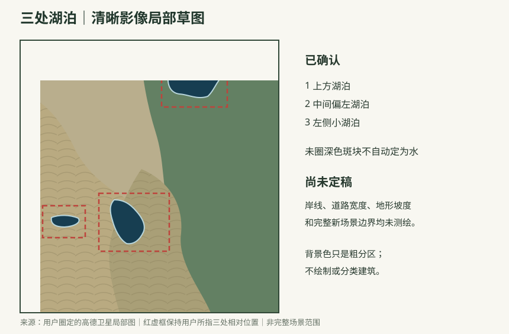

# 和家村三处湖泊局部草图

依据：[用户圈定的清晰高德卫星局部图](Images/HeJiaVillage_UserMarkedThreeLakes_GaodeSatellite_20260927.png)。只使用此清晰图及当前可缩放的高德卫星影像，不对照先前模糊截图。

用户确认红框中的三处黑色水面是湖泊：上方一处、中间偏左一处、左侧较小一处。草图红虚框对应用户指认范围；深色湖形只是便于识别的示意，**不是精确岸线**。未圈出的其他暗色块不自动归为湖泊。

背景仅粗分左侧田块／开阔地、右侧连续植被和中下部田块纹理；不凭颜色推定坡度，也不绘制建筑。用户另行确认的水坝兼水泥路不在本局部草图上强行核位。

本图是三湖附近的**局部草图，不等于完整新场景范围**。道路网络与完整范围需要在当前清晰卫星视野上另行核对，不能把旧草图道路直接移入本图。Unity 场景尚未修改。
