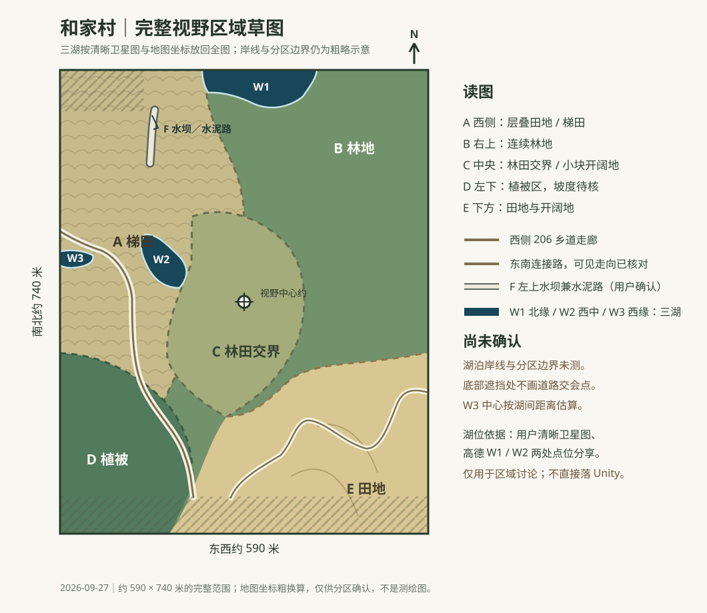

# 和家村新场景：已确认视野区域草图

状态：**完整范围草图，三处湖泊已放回全图；仍待用户确认。**水体判读以[用户圈出的清晰卫星图](Images/HeJiaVillage_UserMarkedThreeLakes_GaodeSatellite_20260927.png)和可缩放高德卫星图为准，不再用先前模糊图判断地物。原有田地、植被大区仍是粗分区，不应视为精确地类边界。

后续局部重画见[三处湖泊局部草图](和家村三处湖泊局部草图-20260927.md)。

| 区域 | 目前可见特征 | 处理方式 |
| --- | --- | --- |
| A 西侧梯田 | 卫星图上有较明显的层叠田块纹理 | 只定大区；田埂数量和线形不定稿 |
| B 右上林地 | 纹理连续、色调较深 | 只定植被范围；坡度、树种和密度待核 |
| C 中央林田交界 | 林地边缘与梯田相接，夹有小块开阔地和通行痕迹 | 旧判读待重核；不能以深色与否排除水体 |
| D 左下植被区 | 与西侧田地、南侧道路之间的深绿色斑块 | 坡度及边界待核，不称“林坡” |
| E 南部与东南田地 | 较开阔的田块及道路旁地表 | 只定大区，农田内部不细分 |
| R1 206 乡道 | 高德标准图有名称与连续道路，卫星图可见田间对应路廊 | 可见中心走向已重新描线；宽度、坡度和精确边缘未测 |
| R2 东南连接路 | 高德标准图清楚显示其从截图下缘附近进入，向东南田地一侧弯行 | 可见路段已重新描线；底部控件遮挡的交会点不画 |
| F 北部水坝路 | 截图左上亮白长条，用户确认既是水坝也是水泥路 | 只标坝路位置；不凭道路推定水面边界 |

水体新证据：用户在清晰高德卫星图上用三个红框确认三处黑色水面均为湖泊。高德标准图缺标不能作为排除水体的依据。已通过高德点位分享读出 W1 上方大湖的参考点约 `112.192513, 27.638195`、W2 中间偏左湖泊的参考点约 `112.190883, 27.635547`（均为高德坐标）；W3 左侧小湖按同一清晰视野中的湖间像素距离外推，中心约 `112.18947, 27.63558`，误差高于前两处。按此前约 `112.192228, 27.634943` 的完整范围中心、约 `590 × 740` 米尺寸换算，三湖分别在草图北缘、西侧中部、最西侧边缘。图中的蓝色轮廓仅示意湖体，**不是实测岸线**。未圈出的其他暗色块不自动并入；建筑不作为分区或场景制作依据。

道路校准：在同一地图中心查看卫星与标准图，通过多个可辨地物估计两次截图之间的缩放和平移，再把标准图道路的可见中心走向转到已保存截图的像素坐标。旧版草图把 R1 与 R2 在无遮挡的画面中提前接合，现已撤回该接点。标准图显示二者交会在截图底部被网页控件遮挡的区域附近，故图中分别画至遮挡边缘，不将隐藏部分当成已确认形状。这是人工图像对齐的草图，**不是 GIS 配准或实测道路中心线**。

接下来应让用户先确认三湖在完整草图中的相对位置，再核田地／植被粗分区和道路。不要用模糊截图补细节；草图确认之前不创建或修改 Unity 新场景。
