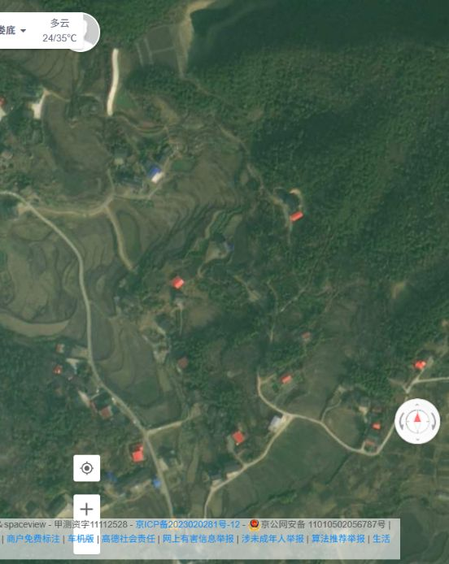

# 和家村新场景：用户确认的高德卫星视野

## 这张图是什么

- 2026-09-27 从用户当时打开的高德地图卫星图层直接截取；用户随后确认：图中**整个可见矩形**就是拟重建的新场景范围。
- 截图保留了当时屏幕可见的地物和高德地图署名。它是规划用的画面证据，不是地理校正影像、地形贴图，也不代表已获得地图瓦片的再分发授权。不要把图像直接作为游戏材质。
- 当时的旧页面 URL 仍带有“新样板 B”标记（`112.188788, 27.625369`）；这个标记**不是**本视野的中心。

## 粗略定位与尺寸

- 在当时屏幕中央用高德“这是哪儿”取得的分享点坐标约为 `112.192228, 27.634943`（高德坐标）。这是视野中心的近似值，不是测绘控制点。
- 依据画面 100 米比例尺估算，可见矩形约宽 `590 m`、高 `740 m`，面积约 `0.44 km²`。浏览器窗宽或缩放变化会改变“整个可见矩形”的范围；后续工作应以本截图为固定参照，不应重新读取任意时刻的浏览器视野来替换它。
- 图中可用来目视复核的特征：左侧梯田，右上林地，下方道路和田地。具体地物边界、道路宽度和高程仍待分区草图核对。

## 后续约束

已另作[本视野区域草图](和家村新场景选定视野区域草图-20260927.md)，先给用户核对并取得确认，再考虑创建或修改 Unity 新场景。旧的 `2_2` 瓦片草图并非这个已确认的可见矩形，不能拿来做本次新场景布局依据。不放建筑或建筑占位方块。
