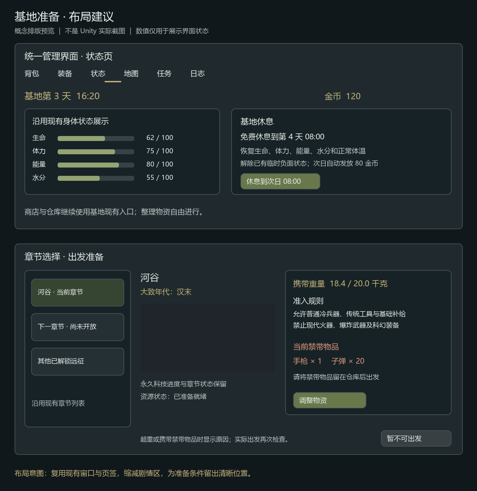

# 基地准备流程技术设计

日期：2026-10-13。状态：已按用户授权直接实施；后文设计调查记录中的“待审阅/再写计划”不再作为执行门槛。当前实施及验证范围见同目录《基地准备流程实施结果-20261013.md》。

## 1. 目标与授权边界

玩家在基地自由完成查看章节、获取准备资金、购买与整理物资、查看携带条件、出发。沿用现有管理页签、商店、仓库和章节选择，不制作强制逐页向导。

依据为用户提供的《基地准备流程改进需求》及本会话逐项确认。现有规则直接沿用，原文已确认规则不重复审批。用户明确要求“不需要再写实施计划了吧，你直接做吧”，已在当前本地项目执行，无另写实施计划。未提交、推送或打包；剩余人工验收按用户节省用量要求跳过。

范围包括基地计时、每日资金、休息、探索开放商品、携带重量、河谷带入准入、地图内超重代价，以及相关保存与界面衔接。保留河谷物资兑换、起点免费补给、工艺解锁与生产、地图资源与活动远征保护。街机、联机规则、其他章节内容、长期伤残和新增伤病系统不在范围内。

## 2. 已确认的产品规则

### 2.1 日期、资金、休息

- 基地与远征均为现实 1 秒＝游戏 1 分钟。基地日期累计，进出章节不重置。
- 只有正常游戏推进时间；暂停、主菜单、关闭游戏不推进。普通整理窗口只阻断玩法输入，时间继续自然流逝。加载与进入/返回事务不推进。
- 继续远征只累计新增时长。沿用远征实际经过时间，不使用每趟随机的 08:00～12:00 钟表起点计算基地日期。
- 每个基地日自动获得 80 金币，允许累积。新存档首日和支持的旧存档首次迁移各发一次；跨越多日逐日补发，包括远征期间。
- 免费休息到次日 08:00；即使当前早于 08:00，也是下一天，不是当天。
- 休息恢复生命、体力、能量、水分至各自上限，体温至 37℃，解除已有临时负面状态；自然跨日只发资金。
- 现有基地自然恢复保留。死亡返回沿用现有死亡处理，回基地后可以休息。不新增付费治疗或长期伤残。

### 2.2 物资存放与商品开放

- 沿用购买进入背包、空间不足拒绝且不扣金币。仓库仍为 40～80 格，每次扩一格消耗金属零件 4、布料 3。
- 基地整理不额外收取时间或金币。仓库不计负重，不承担出征死亡损失。
- 新存档基础开放：急救包 40、口粮 20、瓶装水 20、箭矢 2 金币，均为现价。
- 其他适售物品首次探索取得并成功携带返回后永久开放。购买不限库存、次数，固定价格，不要求统一先学工艺。
- 当地拾取、搜索、制作、获赠均可计为探索取得，但返回时必须仍实际携带；已耗用、丢弃或死亡损失的不解锁。
- 基地带入物品原样带回不解锁，丢下再捡起也不改变来源。同类物品混合堆叠不能丢失来源。
- 旧存档首次迁移时，对已有背包、口袋、穿戴和仓库内的适售物品提供一次继承开放。任务物品、章节凭证、工艺资料和地图资料不作为普通商品。
- 成功返程先识别探索带回物品，再执行原有兑换与清空；不能在清空后扫描。

### 2.3 负重

- 保留固定格子和堆叠，内部按克、显示千克一位小数。
- 出发额度与地图内正常负重标准均为 20 千克，首版固定，无成长机制。
- 背包、口袋、独立穿戴及武器已装弹药均计重。手持只是库存来源引用，不重复计重。
- 地图内允许在其他现有拾取条件满足时拾取至超重。
- 超出每 1 千克，移动速度下降 2%，冲刺体力消耗增加 5%；移动倍率最低 0.5，冲刺消耗倍率最高 2。分数千克连续计算，减重后立即按当前重量更新。

设 `e = max(0, (总克数 - 20000) / 1000)`：移动倍率 `max(0.5, 1 - 0.02e)`，冲刺消耗倍率 `min(2, 1 + 0.05e)`。25 千克对应移动 90%、冲刺消耗 125%。倍率作用于原有速度和冲刺消耗，不替换角色配置、属性覆盖或原冲刺规则。

### 2.4 河谷准入与物品定义

- 河谷允许现有刀剑、斧镐、弓箭、火把、普通材料、食物、水、基础急救用品、普通服装和地图资料。
- 禁止手枪、步枪、穿透枪、手榴弹、火箭筒及对应弹药，以及现有科幻霰弹枪、等离子步枪。
- 仅限制基地带入；地图内取得物品可以使用。普通样例地图和和家村维持现有准入行为，不自动归入历史章节。
- 急救包定义为普通包扎、止血用品，不含现代抗生素；口粮为普通熟制、干燥保存食品；瓶装水为洁净饮水和普通容器，不默认塑料瓶；箭矢为普通弓箭弹药。
- 现有服装按普通织物、皮革用品定义，无现代防弹或电子功能。需要使名称、说明与可见外观一致；发现明显不一致时另列具体美术修正，不在代码中把先进材料伪装为传统材料。
- 本次不给尚不存在的火药时代物品预设完整科技等级。采用当前物品的准入分类和地图允许集合，避免把线性等级当作未经确认的完整科技树。

### 2.5 界面

用户已确认如下落点。图为概念排版，不是 Unity 截图或画面验收证据。

- 统一管理界面的状态页增加基地日期、金币和休息按钮，保留现有身体状态表现；预览中的条形仪表仅作占位，不授权替换现有仪表或人体展示。
- 章节选择沿用列表和详情，缩减剧情区，补充携带重量/额度、准入规则、当前禁带物品清单、调整物资入口。
- 保留永久科技进度、章节状态、资源下载/重试、地图解锁和原有工程保护。超重与禁带同时展示，不仅显示第一个失败原因。
- 调整物资打开现有背包管理界面；整理后回到原章节选择并刷新，不要求从头选章节。商店、仓库和装备继续使用现有入口。
- 出发时重新使用领域检查，不把旧界面显示当作权威。未带武器、工具或补给继续沿用当前可出发行为，不新增最低配装要求。

## 3. 逐物品配置清单

### 3.1 全部当前物品重量

下列覆盖当前 `item.csv` 的 1～48。重量均为单件，武器为未装弹重量；水类包含容器和内容物，地图资料为实体道具而非整个界面功能。

| ID | 物品 | 克 |
|---|---|---:|
| 1 | 金属零件 | 250 |
| 2 | 布料 | 100 |
| 3 | 急救包 | 300 |
| 4 | 口粮 | 400 |
| 5 | 短剑 | 1000 |
| 6 | 弓 | 800 |
| 7 | 箭矢 | 50 |
| 8 | 瓶装水 | 600 |
| 9 | 木材 | 1000 |
| 10～14 | 基地、样例及村庄地图资料，各件 | 50 |
| 15 | 双手剑 | 3000 |
| 16 | 短刀 | 400 |
| 17 | 战斧 | 2000 |
| 18 | 战镐 | 2000 |
| 19 | 手枪 | 1000 |
| 20 | 步枪 | 3500 |
| 21 | 穿透枪 | 4000 |
| 22 | 手榴弹 | 400 |
| 23 | 火箭筒 | 5000 |
| 24 | 科幻霰弹枪 | 4000 |
| 25 | 科幻等离子步枪 | 4500 |
| 26 | 子弹 | 20 |
| 27 | 榴弹 | 250 |
| 28 | 火箭弹 | 1500 |
| 29 | 采集食物 | 200 |
| 30 | 干粮 | 500 |
| 31 | 石材 | 1500 |
| 32 | 精锻斧 | 2000 |
| 33 | 精锻镐 | 2000 |
| 34 | 钢刀 | 1200 |
| 35 | 良弓 | 1000 |
| 36 | 熟粮口粮 | 600 |
| 37 | 陶水罐 | 1500 |
| 38 | 红色连帽衫 | 600 |
| 39 | 橄榄色口袋上衣 | 600 |
| 40 | 蓝色长裤 | 700 |
| 41 | 棕色工装裤 | 700 |
| 42 | 橄榄色便帽 | 100 |
| 43 | 工作手套 | 150 |
| 44 | 棕色短靴 | 1000 |
| 45 | 帆布背包 | 800 |
| 46 | 工具背心 | 600 |
| 47 | 河谷地图 | 50 |
| 48 | 火把 | 500 |

### 3.2 需要补齐的买卖与兑换价格

已有正数买价不改，已有卖价和河谷兑换价不改。下面仅列补齐买价、缺失商品行或缺失兑换行。符号“沿用”表示不覆盖当前值。

| ID | 物品 | 买价 | 商店卖价 | 河谷兑换价 |
|---|---|---:|---:|---:|
| 1、2、9 | 金属零件、布料、木材 | 各10 | 各5 | 沿用 |
| 5 | 短剑 | 50 | 25 | 沿用 |
| 6 | 弓 | 60 | 30 | 沿用 |
| 29 | 采集食物 | 10 | 2 | 沿用 |
| 30 | 干粮 | 20 | 4 | 沿用 |
| 31 | 石材 | 10 | 2 | 沿用 |
| 32、33 | 精锻斧、精锻镐 | 各60 | 各12 | 沿用 |
| 34 | 钢刀 | 90 | 18 | 沿用 |
| 35 | 良弓 | 100 | 20 | 沿用 |
| 36 | 熟粮口粮 | 30 | 6 | 沿用 |
| 37 | 陶水罐 | 30 | 5 | 沿用 |
| 38～41 | 两件上衣、两件裤子 | 各40 | 各20 | 各20 |
| 42、43 | 便帽、工作手套 | 各10 | 各5 | 各5 |
| 44 | 短靴 | 40 | 20 | 20 |
| 45、46 | 帆布背包、工具背心 | 各50 | 各25 | 各25 |
| 48 | 火把 | 10 | 5 | 5 |

新增衣物和火把兑换行仅处理背包/口袋实物。实际穿戴衣物继续现有成功返程保留行为，不为同步解锁而兑换或卸掉。基础商品 ID 为 3、4、7、8；普通商品资格来自正式商店行，而非 `ItemType` 的简单白名单。ID 10～14、47 不新增商品行。

## 4. 工程证据与需要处理的衔接

本节来自本设备实际源文件检查，没有运行验收。

| 现有权威 | 实际行为 | 设计衔接 |
|---|---|---|
| `CurrencyModel` | `BaseOnly`，新建金币0 | 首日资金必须参与基地初始化提交 |
| `SaveSystem` | 按 BaseOnly/ExpeditionOnly/SharedPlayer 捕获、恢复；返程仅复制共享玩家分区 | 基地日历/开放不直接作为共享玩家分区复制 |
| `SaveFileStore`、`IncrementalSaveStore` | 增量存档、Manifest、Journal；只支持当前测试格式 | 沿用存储事务，不能另写独立准备文件 |
| `PlayerConditionSystem` | 基地按实际秒恢复；远征按实际完成的游戏分钟推进，死亡可截断 | 远征日期只取实际已推进时间，不能再叠加一遍帧时间 |
| `ExpeditionClockRules` | 每趟抽取08:00～12:00显示起点 | 与累计基地日期保持独立 |
| `BaseWeatherSystem` | 会话内实际秒天气样板，不保存、不推进日历 | 不把天气样板时钟当作基地日期，也不顺带改天气 |
| `WeaponEquipmentModel` | 背包或口袋实物来源引用 | 手持不另加重量；`ItemStack.LoadedAmmo` 则另计对应弹药实物 |
| `ClothingEquipmentModel` | 七个独立穿戴槽，共享玩家分区 | 穿戴计重、来源跟随转移，死亡仍清空 |
| `CivilisationSettlementPolicy` | 兑换并清空背包、口袋、手持引用；没有38～46和48兑换行 | 解锁识别前置；补已确认的缺失价格；不取消兑换 |
| `ExpeditionFlowSystem` | 成功保存基地后删远征；死亡路径清空物资后再次捕获基地分区 | 防止该次捕获用旧运行态覆盖新日期、金币和商品开放 |
| `PlayerMoveSystem`、`PlayerConditionSystem.TickTili` | 水平速度与冲刺倍率相乘，固定体力消耗 | 在两个正式计算入口接入同一负重快照 |
| `StatusManagementPageCtrl` | 展示身体状态；伤病目前为占位 | 增加休息意图，不新增伤病权威状态 |
| `MapSelectionUICtrl` | 离线与联机共用界面，保留资源/解锁流程 | 新准备信息只用于离线基地远征，不改变联机准入 |

文档/Skill 中某些服务端输出路径已落后于实际入口：当前 `Config/gen.bat` 写入 `Server/GameServer/Runtime/Model/Generated/Config/`，以真实入口为准。它还校验客户端43表、服务端28表；新增客户端表时必须同步准确更新客户端数量，不放宽校验。

## 5. 技术方案与职责

### 5.1 方案选择

推荐“基地权威分区＋远征增量账本”。基地保存最终日期、资金发放日和永久商品开放；远征保存本趟计时锚点与来源数据，返程在同一个基地候选中合并。

对比两种替代方式：每帧同时写基地与远征文件需要跨文件一致性，且容易误捕获远征中途玩家状态；把日期和金币都改成共享玩家分区则会扩大现有资金权限，并在死亡、旧档恢复时覆盖基地结果。均不采用。

### 5.2 建议新增与扩展的拥有者

下列名称为本文提出的设计类型，当前代码中尚不存在，不是已有实现证据。

| 拟新增/扩展 | 职责和权威边界 |
|---|---|
| `BasePreparationModel`，BaseOnly | 累计基地时间、最近已发资金的基地日；不持有第二份金币 |
| `ShopUnlockModel`，BaseOnly | 永久开放的适售 ItemId；基础商品从配置查询，不复制成另一份配置 |
| `ExpeditionPreparationModel`，ExpeditionOnly | 远征ID、基地出发时间、远征耗时锚点、本趟已记账日/资金；不保存基地中途玩家状态 |
| `BasePreparationSystem` | 正常基地计时、跨日记账、休息意图及快照；通过共享生命周期推进 |
| `CarryLoadSystem` | 只读聚合实际携带、负重倍率与地图准入；不负责拾取空间、物资丢失或存档提交 |
| `ShopSystem` 扩展 | 列表过滤、选择与实际交易重检开放资格；保留原金币与背包事务 |
| 返程候选转换策略 | 同步合并日期、每日收入与商品开放；纯数据转换，不写盘或发送事件 |
| 库存领域及序列化扩展 | 保存和转移来源数量，保持物品数量、弹药、火把剩余秒数等原契约 |

Model/System 注册仍走 `Game.cs`；没有新增产品 `MonoBehaviour.Update()`。View 只保留生成引用，Controller 显示快照并提交意图。

## 6. 时间与资金存档契约

### 6.1 基地数据

建议在新分区中使用 `schemaVersion=1`、`totalGameMilliseconds`、`lastGrantedDay`。日期 `floor(totalGameMilliseconds / 86400000) + 1`；内部有界非负 Int64，显示时向下取整到分钟。每现实秒增加60000游戏毫秒，保留运行时小数余量，不能逐帧取整到分钟。

金币仍只有 `CurrencyModel.Gold` 一份。补发金额为 `80 × (当前基地日 - lastGrantedDay)`，检查乘加溢出后在候选中一起推进日标记与金币。资金迁移依据可识别的旧领域版本，不以UI是否打开或分区单独缺失作为判定。

建议基地DTO从当前版本4升级到5，远征DTO从当前版本3升级到4。读取入口仅为当前受支持增量格式保留4/3的迁移解码，写入只允许迁移完整的5/4；新版本缺少必需准备/来源字段按损坏拒绝，不能再次当作旧档发80金币。领域版本与新分区版本同时参与验证，不更改既有Task/Clock子版本或Manifest协议。原存档ID和基地代际保持不变，通过现有Journal一次写入领域版本与全部新增字段；不得发布新基地代际令仍活动的远征失去OwnerBase关系。

**本稿新增的起始日期建议，随本稿审阅确认：** 新存档及无法重建历史日期的支持旧存档，从基地第1天08:00起步。旧存档只加一次80金币，不按现实存档年龄补历史收入。基地时间不取系统日期或文件 `UpdatedAtUtc`。

### 6.2 远征账本

- 出发前先把基地时间、首日/跨日资金、商品开放与玩家物资提交到现有基地事务，再生成远征候选。
- 远征分区记录当前 `ExpeditionId`、所属基地存档代际/身份、基地时间锚点、远征 `ElapsedGameMinutes` 锚点、已记账日和累计每日资金。Identity 使用真实增量存档关系，不发明跨槽全局身份。
- 有效基地时间等于基地锚点加“当前远征耗时减远征耗时锚点”，只使用 `PlayerConditionSystem` 实际提交的时间。暂停与死亡截断自然反映在该值中。
- 跨日收入自动记入远征账本，随远征文件保存。这是同一基地金币的待合并增量，不是第二种货币。出征期间没有基地商店/生产消费入口，金币可展示为基地已存金额加本趟记账收入；不为到账去修改币种权限或写入基地中途玩家数据。
- 返回时将账本日期、收入与最近已发日一次并入基地金币。同一远征以现有 `SettledExpeditionIds` 去重；既已结算则使用已提交基地结果，不再合并账本。
- 继续远征恢复原锚点，禁止以“旧基地时间＋本次已保存的全部耗时”反复重建。所有币值、日标记和计时锚点在保存验证中检查一致性。
- 读取新旧混合或不一致的准备分区时拒绝恢复并给出明确错误，不能用缺失默认值掩盖部分保存失败。

### 6.3 休息事务

先验证稳定离线基地、存档、角色上限和流程状态，再建立日期/金币/生命/条件候选。目标是下一基地日08:00，不逐分钟模拟整夜生存消耗。

快照包含日期、资金记录、金币、Combat/Condition以及运行期冲刺状态。修改和写盘在同一基地提交中完成，成功后统一发布事件；失败恢复完整快照，不显示休息成功，不消费“当天已发”标记。重复点击在事务进行时拒绝，完成后的再次休息是用户明确允许的新一天操作。

已存在可处理的负面状态包括异常体温、能量/水分不足和体力耗尽。生命/状态补满同时重置耗尽后的冲刺锁与按压状态，仍保留“松开再按”的输入保护；不把伤病占位字段虚构成已有系统。地图/存档处于加载、返回、失败恢复或联机域时不能休息。

## 7. 首次带回来源契约

不能采用“本趟曾见过某ItemId”集合，因其会让已消耗的探索物品和仍带着的基地同类物品误解锁。建议按数量保存来源批次：基地来源或当前远征来源，远征来源携带稳定的本趟ID；武器装填的弹药亦保留对应来源数量。

来源在堆叠、拆分、移动、穿脱、装填、卸弹、发射、使用、制作投入、赠送、丢弃、拾取、尸体搜索和存档恢复中守恒：

1. 新出发时全部携带实物是基地来源，旧成功探索物品也不继承上趟身份。
2. 当地实际取得的新增数量记当前远征来源；基地带入物品丢到地上或容器后仍是基地来源。
3. 混合堆叠使用确定性批次顺序，消费/拆分优先较早进入的批次；不得在库存移动时重新生成来源。来源顺序采用本趟持久单调序号，既有基地数量先于本趟取得数量，序号不复用库存的运行期Guid或MapInstanceId；序号计数器与批次随同一远征候选保存。无需新增玩家逐件选择来源的界面。
4. 来源数量之和等于实际数量，装填来源数量之和等于装填弹药数量；跨远征身份、负数、数量不符等拒绝保存/恢复。
5. 成功返程扫描背包、口袋和独立穿戴，武器来源引用不重复扫描；当前仍装在武器里的当地弹药也属于实际携带弹药。
6. 在河谷兑换前生成本次开放集合，并与兑换、工艺归档和远征去重标记放入同一基地候选。穿戴物品虽保留，也参与解锁。
7. 死亡路径不生成本次开放集合；已有永久开放和仓库保持原值。

需要同时扩展 `ItemStack`、`ItemSlotSaveData`、槽位JSON、世界掉落/搜索记录及其Clone、增量Codec/恢复链，不能只改玩家背包的JSON。现有Codec默认可按索引保存新增批次数组，优先验证并沿用，不为它添加无必要的新集合协议。火把剩余时间、库存运行期身份和已装弹药契约必须保留。

### 7.1 支持旧档的迁移边界

“旧存档”仅指当前 `SaveFileStore` 已支持且能正常读取的增量格式。其 `CleanupLegacyFiles` 当前明确保留但不导入更早测试格式；本次不扩展为所有历史文件导入工具。

基地旧档先生成准备、开放分区候选，读取该基地持久背包/口袋/穿戴/仓库中的适售ID，和80金币一起写盘，成功后恢复运行态。只读Inspect不发钱，不保存不完整迁移结果。

**本稿新增的旧活动远征迁移建议，随本稿审阅确认：** 当旧档仍有进行中远征，无法证明当前物品来源时，不把整份远征背包无条件视为成功带回；继承开放只扫描基地持久物资。以旧远征已保存耗时为锚点，从迁移后新增时长开始计基地时间；迁移前远征随身物品保守记为基地来源，迁移后取得的物品正常参与解锁。死亡/已失败远征的物品不通过迁移变为永久商品。

基地迁移成功而远征迁移尚未完成时可以重试，首日金币不再重发。远征迁移候选保留原ID、耗时、世界、状态与所有旧物品；只有两份所需候选均成功保存后才恢复远征，失败不得删除旧文件。

## 8. 返程事务与故障恢复

正常、死亡、启动时直接结算及失败重试必须复用相同准备合并规则：

1. 保存可重试的远征快照，包含账本、来源和实际耗时。
2. 读取并克隆基地DTO，验证同槽身份和远征ID；已结算时返回已提交结果。
3. 合并日期与每日资金；成功时先计算开放ID，再按原有河谷政策兑换/清空。死亡仍按现有风险规则清空随身物资和穿戴。
4. 在同一基地候选中写金币、日期、开放、玩家结果与结算ID，校验后一次提交。
5. 保存成功后恢复基地权威，再执行原有远征删除与基地加载；删除失败按原流程重试，不重新加钱或解锁。

特别处理死亡路径：现有 `CaptureBaseSections` 在结算后捕获所有基地Provider，可能覆盖刚计算的日期/金币/开放。改为从候选保留BaseOnly结果，仅捕获死亡后需要的共享玩家结果，或者在受控快照中先安装准备候选再捕获并完整回滚；正式计划应采用前者，避免扩大内存临时状态。仓库和营地世界不能被远征中途状态替换。

返回过程中基地已保存但远征删除失败，重试只完成清理/恢复；基地加载失败则保留已结算结果，进入原有恢复入口，不重新开始已无文件的远征。结算纯转换不发布商品开放事件，事件只在保存并恢复权威后发布。

## 9. 负重与出发检查

携带快照逐一遍历背包、口袋、七个穿戴槽；`LoadedAmmo × AmmoItem.WeightGrams` 计入，不遍历手持快照追加。检查整数乘加溢出、物品重量配置和弹药引用，缺失规则拒绝出发并给出配置错误，不能按零重量放行。

准入同样检查全部实际物品及已装弹药；不是只检查武器类别。显示禁带物品名称、数量与所在容器，重复类型可合并为清单但仍保留实际位置用于整理。

新检查置于 `ExpeditionFlowSystem` 正式离线新出发入口，任何风险状态、物资、候选文件或地图变更之前。保持已有地图解锁、资源、任务配置、活动远征、库存风险、死亡与恢复保护；异步资源准备完成后重新检查实际携带，不能只检查第一次按钮点击。

继续远征不是基地带入，不按新出发重量/准入重查旧随身物资；地图内超重的旧局仍可恢复。地图内拾取不增加重量拒绝分支。

`PlayerMoveSystem` 使用基础水平速度×原冲刺倍率×负重移动倍率；`TickTili` 只在实际冲刺扣体力时乘负重消耗倍率。离线远征生效，基地和联机保持原移动/冲刺行为；不将负重惩罚写回基础属性，避免反复乘算或减重后残留。

## 10. 配置与UI实现约束

### 10.1 Luban

建议新增三张客户端 `c` 组表：

- `item_preparation.csv`：ItemId、单件克数、实际技术分类，覆盖全部当前物品。
- `base_preparation_rule.csv`：唯一规则行，时间倍率、起始时刻、每日金币、休息时刻、重量标准与惩罚参数。
- `map_preparation_rule.csv`：地图ID、是否限制技术、允许分类集合。河谷限制；已存在普通离线样例/村庄显式不限制，不以未知地图缺行作为无限制默认值。

分类首版采用传统物资、现代火器/爆炸物、科幻装备、地图资料四组；不是科技等级。未来需要材料例外时依据具体物品配置细分，而非在UI按名字判断。

现有客户端 `ShopItemConfig` 增加基础开放标记，适售资格以正式商品行和正买价表达。补 `shop_item.csv` 及 `civilisation_return_value.csv` 的确认行，修改基础补给说明与相关正式语言表。所有表通过手写 `IRuntimeConfigProvider`、Definitions、Luban适配器转换为只读领域规则并验证引用。

选择客户端附表是因为 `Item` 属于双端共享 `e` 组，而本需求不改变联机负重/准入规则；不为离线准备扩大服务端物品字段或规则。正式生成仍运行唯一 `Config/gen.bat`，预期客户端从43表增至46表，服务端仍28表；生成后的实际数量按最终Schema核对。禁止手改生成代码/bytes，新增Unity产物携带meta。

### 10.2 UI

- 修改正式状态Page、其在Bag中的引用关系、MapSelection及相应Controller；保留已有状态仪表、分页和列表组件。
- 日期/金币/重量为Controller更新的动态文本，不挂 `LocalizedText`。固定文字用正式语言Key，TMP预览写可读中文。
- 状态Page新增引用后执行 `Assets/智能更新Page`；宿主引用变化执行对应独立UI生成；MapSelection执行 `Assets/智能更新UI`，不手写生成View字段。
- 禁带清单若按行管理，则使用独立Box Prefab与宿主 `CustomListView`，由集合组件创建/回收；不用Controller手动Instantiate或内嵌模板。
- 订阅日期、金币、库存、装备、语言与恢复结果，随可见生命周期解绑；多次显示、重绑、关闭后的异步回调不能重复休息或出发。
- 两个操作之间保留地图选择，清理拖拽、数量弹窗和EventSystem焦点。联机模式隐藏离线准备信息及休息操作。
- 移动端沿用原有Canvas缩放与输入布局，禁带清单支持滚动；实际截图验收后调整尺寸，不用代码修补静态Prefab布局。

本次不新增/修改玩家测试指令，避免为验证顺便扩展指令产品范围。若正式计划确有必要新增指令，必须连同两张目录CSV、说明、覆盖清单和正式配置生成一起单独列出。

实现时同步为核心类、关键函数和重要字段补充简洁中文XML注释，说明数据权威、调用时机、失败与幂等语义；生成代码仍由生成器维护，不手改注释。

## 11. 验证设计

本文仅制定验证目标，没有执行任何下列测试。正式实施计划需给每次Unity调用列出存在的短类名或全限定方法、Mode、精确测试清单与最大执行数；禁止全量、仅程序集或命名空间过滤。`includePassingTests=true`，返回后逐项核对执行范围。

| 聚焦领域 | 必须覆盖 |
|---|---|
| 日期/资金 | 新档首日、旧档一次迁移、暂停/整理、跨多日、远征继续、不重复计时与发钱 |
| 休息 | 次日08:00、恢复全部状态、重复点击、保存故障完整回滚、死亡后可休息 |
| 来源 | 同类混堆、拆分转移、基地丢弃再捡、使用/发射、穿脱、装填、世界恢复、旧活动远征迁移 |
| 商品 | 初始四种、成功才开放、死亡不开放、保留穿戴解锁、兑换清空前解锁、旧选择绕过购买被拒绝 |
| 返程 | 成功/死亡/直接结算、保存失败、已保存但删除失败、重启重试、仓库和金币不被捕获覆盖 |
| 负重 | 48项覆盖、口袋/穿戴/装填计重、手持去重、20kg边界、25kg双惩罚、倍率上限与减重恢复 |
| 准入 | 河谷名单、装填禁带弹药、样例不套历史规则、继续超重旧局、正式入口重新检查 |
| 配置/UI | Provider实际生成目录、客户端/服务端数量、商品/兑换覆盖、Prefab反序列化与所有生成字段、列表复用与本地化 |

可参考现有 `ShopSystemTests`、`ShopRuntimeConfigTests`、`CivilisationSettlementTests`、`ClothingSaveTests`、`PocketInventoryTests`、`ExpeditionClockTests`、`StageSixPlayerConditionCoreTests`、`MapSelectionUiTests` 及Flow目录的存档/继续远征测试；新增准备专属小类避免运行无关整套。具体选择在计划中根据最终修改和真实测试数量确定。

Unity测试若被脏Boot阻挡，按项目授权通过MCP从磁盘重载且不保存。不得运行PlayMode全套、新增PlayMode自动化或任何打包/Player Build。

人工画面验收需实际基地状态页、商店、仓库、背包/装备、章节选择的截图，以及地图内25kg前后移动和冲刺表现。概念图、静态代码检查、EditMode通过都不能替代画面验收。

## 12. 审阅与后续交付

已逐项确认的产品规则不再询问。请审阅本文技术边界与事务设计，并特别审阅第6.1节起始日期、第7.1节旧活动远征迁移这两项此前未明确的建议。

本文审阅通过后，编写正式实施计划，按配置与来源基础、时间/资金/休息、商品与返程、负重/准入、UI及集中验收依赖安排可检查的步骤。实施计划形成后再确认执行方式；不自动创建worktree、委派子代理、提交推送或打包。
