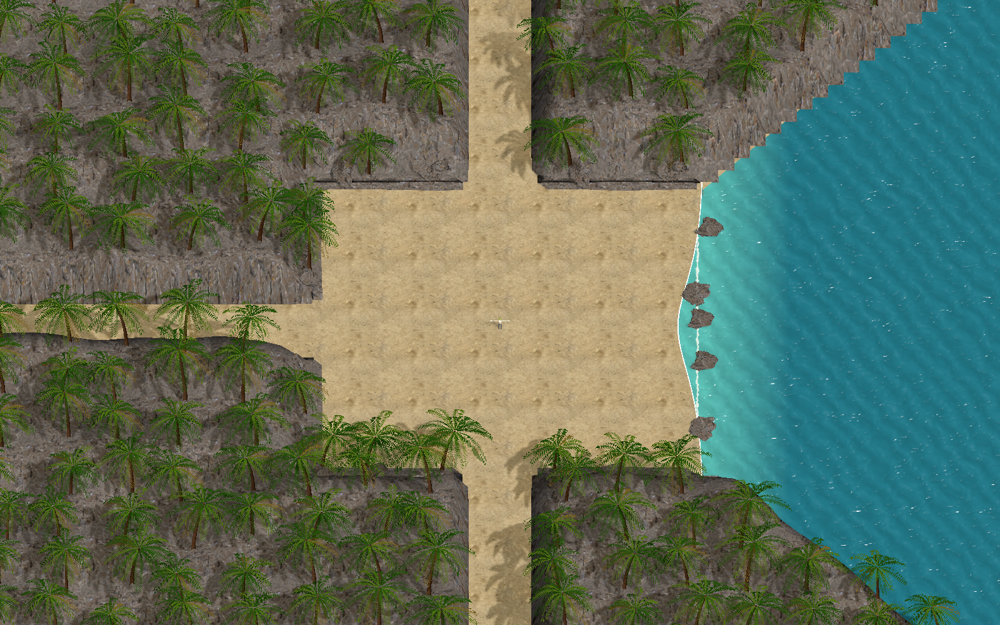
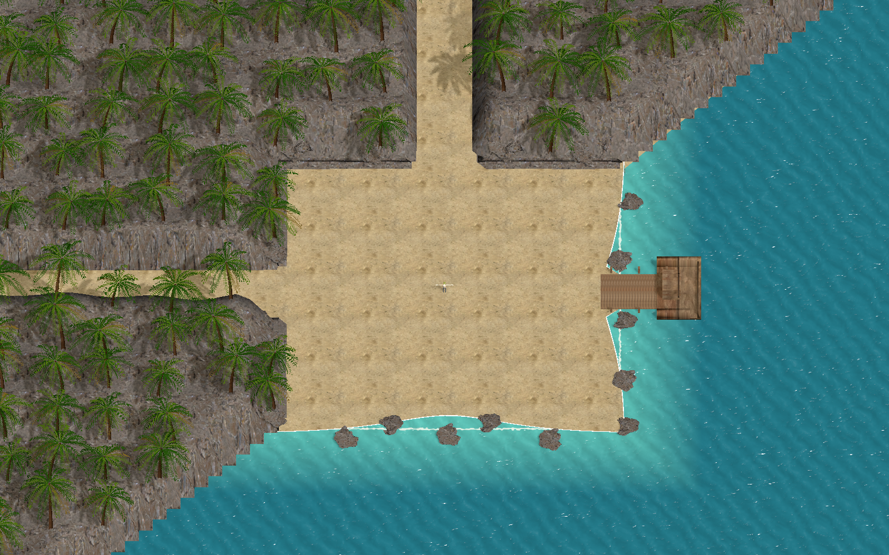
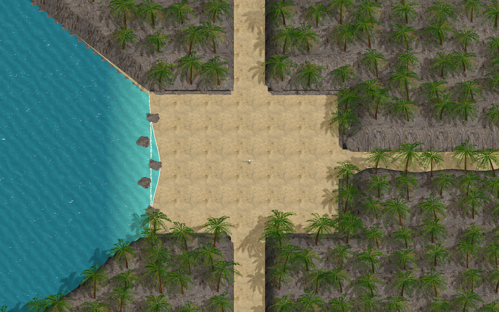
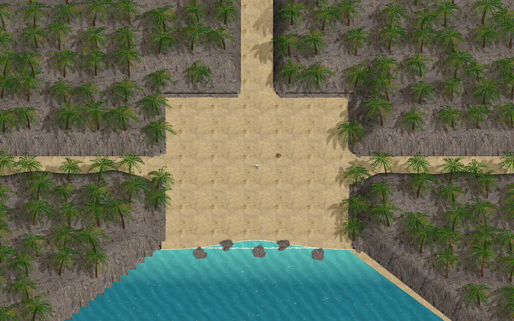

# 海岛已确认部分实施（2026-10-22）

用户明确授权现在开工，后续尚未确认的项目暂不制作。本批只落实四张已看过概念并认可的固定海岛，按最新要求扩大中央活动区、缩小山地向场内的占用；以及与地图配套的真实通道、分段随机入场、无方向提示、清场接触通道过轮。正式持枪、掉落物放大／箱子比例、宝箱、传送门、无人机新动态、码头和农场等未展示确认部分保留后续，不借本批接入。

## 顺序与验证

1. [x] 以真实目录和战斗入口写定向失败测试：中央通行、三通道、海岸朝向、连续入场及随机分段。
2. [x] 调整四图同源轮廓与权威配置；共享活动时钟供单双人选通道，不新增预告。
3. [x] 使用已有样板资源制作外围山林、第二轮码头停船；正式资源保留原内容与meta，按当前轮显示并释放。
4. [x] 定向验证资源就绪、几何／碰撞、过轮、暂停／恢复及单双人规则；保存正式渲染截图。
5. [x] 审查实际差异，修复问题并完成验证；最终按项目授权中文提交并推送origin/main。

## 范围裁定

- 继续当前工作目录，不创建worktree；不打包、不修改Player Build。
- 地图是固定手工配置；随机只选当前活动通道，同一通道允许连续抽中。
- 内轮出口沿用已确认的通道接触推进；整关中央传送门及后续场景未确认外观，本批保留现有整关流程，明确记录未完成部分。
- 中央约30×30米保持干燥、畅通；山林主要在原场地外围及镜头外延展，不能为了扩大空间再次露出空边。
- 数值是项目选择：通道分段首版12个活动战斗秒，暂停／准备／清场不计时；没有方向箭头、提示音或预警停顿。
- 本批不改变战斗掉率、武器种类或强化数值，避免拆开尚待视觉确认的空投与奖励闭环。

## 实施记录

- 起点：main，40e04846；工作区干净；Unity连接Client，Boot干净、编辑态。Console有3条既存resourceServer为空异常，尚未判定为本批问题。
- 新几何测试首次6项中5项失败、原入场测试首次2项失败，完成共享规则后转绿；旧四向／预警／内场沉船断言随已确认的新地图规则更新。
- Config/gen.bat成功双端生成新增EntrySegmentSeconds字段及80行布局；正式变化限海岛4行几何和全表新增12秒默认值。没有改掉率、武器池、敌群数量或攻击属性。
- 固定海岛复用仓库已追踪的CoastStudy网格、材质与贴图；不依赖未发布美术缓存。Prefab仍不带Collider，山脚实体归权威配置根，空气墙只留在三个通道。第二轮停船和木板平路从场外接敌。
- 修复水面样板只裁剪东岸的问题：新水面材质按四图朝向呈现，不修改原样板Shader；Shader检查0条消息。
- 正式资源实拍见下方。由真实表现控制器和真实资源加载后，在独立编辑场景渲染；与正式主角同框，用于查看比例与固定地形，不冒充实战、移动设备或双客户端运行录像。
- 最终独立只读审查发现2项Important：倒序回调露出通用障碍、每个障碍重复实例化整套四图。补充2项回归先复现失败，再修复；障碍只创建实际选中变体，固定地形每次同步覆盖晚到外观。
- 修复后11项资源回归与6项通用障碍回归通过；本批共89项定向检查通过，无未修复审查问题。Git diff --check通过，新增资源.meta齐全，22个样板美术依赖全部为已追踪文件；截图按修复后的控制器重新渲染，Boot场景仍干净。

## 正式资源实拍

| 第一轮：东岸与三条陆路 | 第二轮：东南海岸与停船通道 |
| --- | --- |
|  |  |
| 第三轮：西岸与三条陆路 | 第四轮：南岸与三条陆路 |
|  |  |

## 验证与边界

- 按指定非空短类或完整方法筛选，逐次有限范围执行并包含通过项；未运行全套测试，未执行Player Build。
- 规则、移动、过轮与资源回归记录见[验证记录](Artifacts/IslandConfirmed-20261022/verification.md)。测试里的临时存档与隔离架构不读取真实玩家数据。
- 没有双客户端实跑、移动端性能测量或第一人称全视角录像；本批证据不证明这些体验已经通过。
- 后续整关传送门、武器外观、掉落与宝箱、无人机动态、第二／三关新场景仍待展示确认，本批不制作。

## 执行裁定

- Ruling: 保留当前main工作目录，不建worktree并按项目授权提交推送origin/main；代价是依赖严格限定本批文件，不能夹带Unity自动生成的无语义改动。
- Ruling: 本批只做已确认四图和通道闭环，整关中央传送门及其他未确认视觉留后续；代价是整关结束暂沿用旧流程，不能把前三关总计划宣布完成。
- Ruling: 首版每段12个活动秒，独立随机且允许重复；代价是连续抽中同方向时玩家会看到更长的同向入场，符合随机而非固定顺序要求。
- Ruling: 样板美术来源白名单扩展为本次已追踪的22个CoastStudy依赖，继续拒绝其余Assets/Art缓存；代价是后续更换依赖时需同步审查清单。
- 审查中未判定的真实双客户端、移动性能及第一人称动态观感，保留为验证边界，不以静态实拍代替；完整套件及打包按项目规定不执行。
