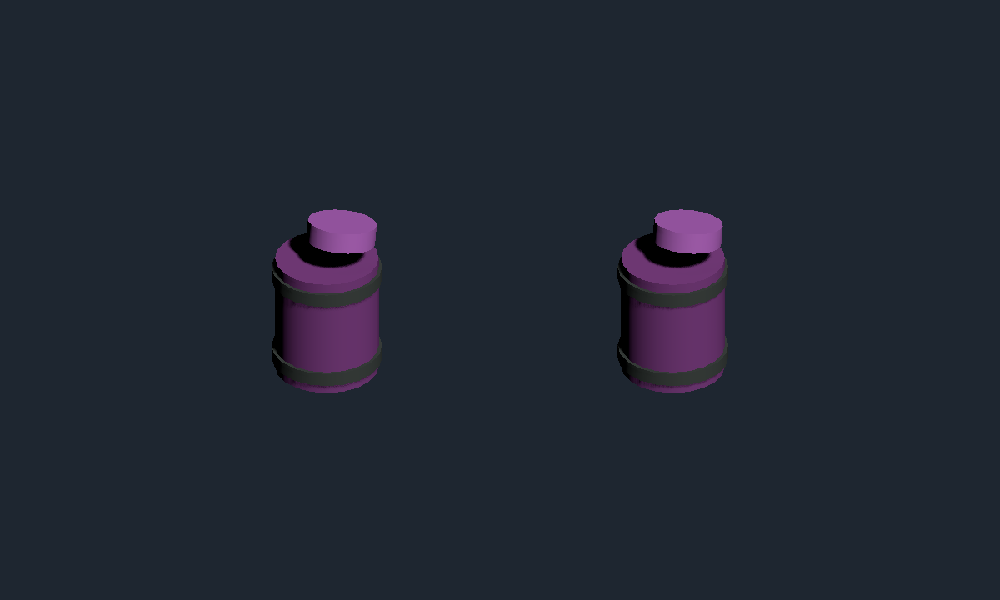

# 漩涡桶与电塔验证（2026-10-20）

用户授权补齐此前分析的三类功能：载桶敌人、固定／落地漩涡桶、固定通电塔。本次在当前工作区实现，无提交、无 Player Build。

## 行为

- 载桶敌人提前死亡时保留敌人范围爆炸；存活达到配置5秒后放一次独立桶，卸桶后成为普通敌人，死亡不重复爆炸。单双人都使用地图活动时钟上的出生年龄，眩晕或冻结移动不延迟卸桶。存量桶不会阻止后续卸桶。
- Barrage四图原有预置桶保留。预置桶和动态桶共有40耐久，吸取12米内已落地物资，移动速度2.5米/秒，到桶口删除；不触发拾取、不加分、不返还。未开箱的武器空投不被吸取。桶爆炸及载体爆炸只伤敌人；伤害半径和敌人伤害比例沿用项目配置，未改成原作精确参数。
- 通电塔已有安全、预警、通电循环及玩家／敌人裁决，本次保留该实现，复验正式配置、致命接触、护盾、冲刺、无敌、接触冷却和表现释放。当前项目周期为安全4秒、预警1.5秒、通电3秒。
- 轮内容暂停、清场、切图、复活等待及全员奖励房期间冻结；动态桶和剩余耐久属于当前地图现场，断线或重开沿用既有轮前回滚，未扩展为即时世界存档。
- 动态桶使用既有内容快照 Kind=13；预置桶仍为 Kind=11。服务器持有位置和吞物结果，客户端只投影。编码往返检查覆盖动态桶身份；未变更协议 Schema。

## 配置与资源

只修改 `Config/Defines/beans.xml` 和 `Config/DataCsv/arcade_round_layout.csv` 权威结构与参数，通过 `Config/gen.bat` 双端生成。规则指纹更新为 `firepowerloop-20261020-v12-vortex-barrels`。未手改生成代码或 bytes。

紫色桶体、金属箍和随权威时钟变化的旋涡使用正式表现代码创建；无额外 Collider，无独立 Update 推进。下图是正式表现的隔离渲染，用于检查预置桶和动态桶的外观，不是完整战斗截图。

## 定向验证结果

连接项目为 `E:/GitHub/FirepowerLoop/Client/Assets`；验证结束时 Boot 场景无脏状态，Editor 未播放、未编译。

所有调用都声明真实短 testClass 或完整 testMethod，指定最大范围，`includePassingTests=true`；未运行完整套件。

| 范围／过滤 | 声明最大数量 | 最终结果 |
| --- | ---: | ---: |
| Unity EditMode `GroundBarrelFlowTests` | 13 | 13/13 |
| Unity EditMode `ArcadeRoundContentViewTests` | 7 | 7/7 |
| Unity EditMode `ArcadeHazardTests` | 29 | 29/29 |
| Unity EditMode `ArcadeRoundLayoutTests` | 5 | 5/5 |
| 服务器 `VortexBarrelOnline` | 6 | 6/6 |
| 服务器 `GroundBarrelRegressionOnline` | 8 | 8/8 |

合计68项定向检查通过。服务器命令使用 `dotnet run --no-restore --project Tools/ArcadeFullRouteOnlineChecks -- testClass=<上表过滤> maxTests=<上表数量> includePassingTests=true`，只运行离线权威逻辑，不启动服务器监听、不访问玩家存档。NuGet 报 NU1900 漏洞数据源连接警告，不影响编译和检查通过。

新行为先复现失败再修正：放桶／吸物／耐久／玩家保护，以及表现 Kind=13；审查又发现存量桶上限与联机移动计时问题。新增30次卸桶测试及晚出生受控敌人的真实 `TickEnemies`／`TickRoundContent` 推进测试后，先得到单人0/1和服务器4/6，再修正为13/13和6/6。只读复核确认两项问题关闭，无新增明确问题。

修改文件的定向 `git diff --check` 通过。工作区另有既存改动，未清理或提交。

## 验收边界

已验证逻辑、正式配置、表现对象和服务器快照编码；尚未完成真实双客户端自然战斗、网络延迟与完整场景视觉验收。以上不等同于原作逐帧／逐数值复刻，也不表示整项目全套测试通过。
