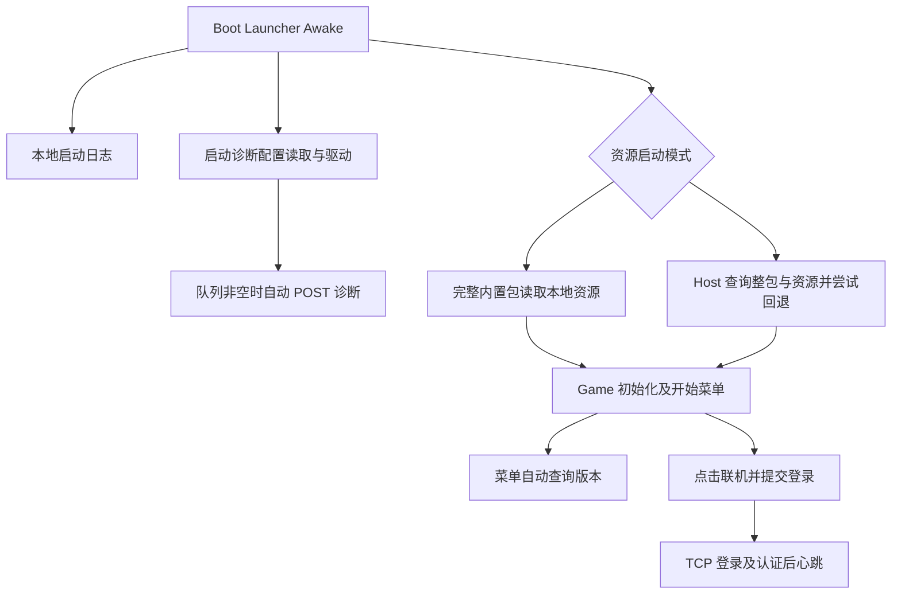

# FirepowerLoop 启动数据流与隐私初始化检查

范围说明：下述调用链描述内部／联网模式。当前首发采用[独立纯离线模式](单机首发模式与验证-20261021.md)，停用诊断、更新及连接并隐藏相应入口；下述地址和时序不能直接作为纯离线包行为。最终 APK 及真机流量仍待验证。

2026-10-21。当前客户端具备启动日志、自动诊断、资源检查及账号联机链路，但尚未在这些入口前形成统一的隐私选择状态。完整内置资源包也不能据此描述为“整个启动过程不联网”：Boot 的资源初始化可以离线，诊断和进入菜单后的版本查询是独立路径。

本次依据当前工作区源码及配置进行静态检查，保留单人、双人、本局强化和分数结果范围。没有修改运行逻辑、生成配置、运行游戏、打包或发送测试业务请求；请求时序与实际发包范围仍需后续真机抓包验证。

## 当前启动顺序

| 阶段 | 触发与实际行为 | 失败或取消 |
| --- | --- | --- |
| Boot Awake | `Launcher` 创建启动日志，清理旧更新缓存；`BeginBoot` 读取诊断配置。Android 使用 UnityWebRequest 读取 APK 内 StreamingAssets，属于本地包读取，不应直接计作访问公网 | 日志写入失败降级；诊断配置错误显示不可用，不阻断资源启动 |
| Boot 诊断 Tick | 配置完成、目标有效、队列非空且满足重试时间时自动上传；不要求打开设置页或先点击上传 | 5 秒请求超时；失败保留批次，按 30、60、120、240、480、960 秒退避，后续维持 960 秒 |
| 完整内置资源包 | `FIREPOWERLOOP_ANDROID_BUILTIN_RESOURCES` 选择 OfflinePlayMode，Boot 不读取 Host 地址，不进行远端资源初始化 | 必需内置资源损坏会显示失败；不会靠声明“离线”绕过本地资源校验 |
| Host 包 | 读取默认及玩家覆盖地址，先检查可选整包更新，再检查资源版本、清单与所需资源；资源不可用时依次尝试成功缓存、内置资源 | 整包检查失败可跳过；资源回退都不可用时保留失败及对应重试入口 |
| 主场景初始化 | `GameStart` 初始化架构、配置和设置，再显示开始菜单；网络运行时初始化仅创建组件并保持 Disconnected，不等于已经连接登录服务器 | 初始化失败交回 Boot 失败页；日志驱动由 Boot 转交 Game |
| 开始菜单显示 | `StartUICtrl.OnShow` 自动调用 `CheckUpdate(false)`；资源版本及当前平台整包查询会发起读取，自动入口不展示更新公告 | 检查失败更新状态，不等于“已经没有更新”；不自动安装 |
| 用户提交登录 | UI 将用户名、密码交给 `OnlineAccountSystem`，加载地址并连接 GameGate，再发送登录 RPC。初始化只回填用户名，没有自动提交密码登录 | 输入先校验；连接超时 8 秒、普通 RPC 超时 10 秒；显示相应错误，完成后清理密码输入框 |
| 登录成功后 | 回包带账号 ID、玩家 ID、SessionEpoch 等；开始周期心跳；登出、断线及会话替换由账号系统处理 | 心跳正常间隔 2.5 秒、超时 10 秒；恢复时另有 3 秒期限，不把失效会话当作仍已认证 |
| 手动更新及安装 | 主动检查可读取更新公告；APK 下载、安装继续由既有 Boot 流程协调，玩家确认后交给 Android 系统 | 可以取消；安装来源授权与系统安装结果独立于下载完成；安装权限不代表已安装成功 |

## 请求与接收方

这里的地址是源码默认或当前配置，不能代替手机上的实际连通记录。

| 路径 | 当前目标与数据 | 触发条件 |
| --- | --- | --- |
| 诊断 POST | `LocalGameServer` 根据联机 IP 推导 `http://192.168.31.94:31012/diagnostics/errors`；玩家联机地址覆盖可改变目标。`reportUrl` 为空不会关闭此模式 | 自动队列发送，以及设置页手动补传 |
| 资源服务器 | 包内默认 `http://192.168.31.94:8001`；Host 可应用 `resource-server.json` 覆盖。GET 资源版本、清单、资源文件与整包发布描述 | Host 启动及菜单检查；模式不同，实际使用的地址不同 |
| GameGate | 包内 `192.168.31.94:31011`，可由 `Online/network-endpoint.json` 覆盖；普通 TCP 承载账号与房间协议 | 登录提交后连接；认证后发送心跳、房间及双人游戏消息 |
| 资源版本与公告 | `/DefaultPackage.version`、`/resource-update-notices.json?t=时间戳`；APK 描述 `/app-update.json`，下载 `/app-updates/android/文件名` | 版本检查、主动公告读取与确认下载；包名和本地版本主要用于客户端筛选，不能把方法参数直接当成请求上传字段 |

HTTP/TCP 接收端天然能观察连接来源。诊断接收代码读取远端 IP，并在受信代理配置下处理 X-Real-IP，用于内存限流；当前诊断 JSONL 记录结构没有 IP 字段。真实反向代理、系统访问日志和备份保留期还需结合部署核对。

## 数据内容与存储

本地路径均相对于本应用的 `Application.persistentDataPath`，没有读取或迁移 AnotherDay 玩家数据的授权。

| 数据 | 已确认字段或内容 | 去向与保留方式 |
| --- | --- | --- |
| 诊断统计 | 批次 schemaVersion、batchId；每组 source、kind、fingerprint、buildVersion、platform、eventDate、firstUtc、lastUtc、count、bootCode、bootStage | `Diagnostics/queue.json`，最多 128 组及 256 KiB；按 UTC 日期保留今天及前 6 天。每批最多 20 组并限制 16 KiB，确认成功才扣除；服务端 `Store/Diagnostics` 按日 JSONL，保留今天及前 29 天 |
| 诊断中的错误位置 | Runtime 只将调用栈计算成 SHA-256 指纹；Boot 用错误码与阶段形成指纹 | 自动统计字段没有用户名、密码、设备唯一标识、原始日志正文或调用栈。诊断指纹是错误分组依据，与签名证书指纹无关 |
| 启动及运行日志 | 启动阶段、版本、平台、Unity 版本、警告或异常正文与堆栈；运行日志另有完整消息队列 | `Logs/boot-startup.log` 每次启动覆盖、上限 256 KiB；`boot-error.log` 保存最近失败；运行错误日志当前与上一份各设 1 MiB 上限。手动导出生成 `RuntimeLog-时间戳.txt`，与自动诊断上传分开 |
| 登录资料 | 用户输入的用户名、密码；成功后返回账号和玩家身份、会话代次等 | 密码参与登录 RPC；客户端账号偏好文件仅保存 version、lastUserName，不保存登录密码。用户名位于 `Online/online-account-preferences.json`，未见到期清理 |
| 服务端账号 | 规范化和显示用户名、账号/玩家 ID、密码盐与哈希、算法版本、创建时间；玩家显示名、修订号等 | 使用 `Options.OnlineStore` 选定的 JSON；登录时不存在的账号可自动创建。密码落盘为 PBKDF2-SHA256 盐化哈希，当前迭代 600000 次；此做法不保护传输中的密码 |
| 房间与双人业务 | 房间状态、玩家身份、聊天 Content、ClientMessageId，以及对局指令与分数结果 | 通过已连接的服务器链路交互。聊天发送是用户主动操作；服务端聊天与对局数据的完整持久化、清理周期需另作专题核对，不能套用诊断 30 天规则 |
| 分数与本局状态 | 单人当前局/恢复节点及结果；双人 RunId、Outcome、Scores | `Saves/arcade-run.json` 及备份；双人 `online-result-玩家ID.json`。本轮没有新增局外钱包或奖励 |
| 地址与设置 | 玩家选择的资源地址、联机地址、操作与显示等偏好 | 本地覆盖文件或设置；不是隐私授权状态。删除诊断队列不会清除账号偏好、存档或所有日志 |

设置页提供“上传诊断”和“清理诊断”。清理会删除当前队列、取消在途发送并清空待处理快照，但错误采集和自动发送机制仍存在，之后发生错误会再次入队。因此清理不是持续关闭上传，也不是撤回同意。

## 检查发现与当前处理状态

### 1 登录协议日志包含密码 已修复

初次检查时，`NetworkRuntime.CallAsync` 调用的日志函数直接对整个消息执行 `JsonConvert.SerializeObject`，而登录请求包含 Password。Editor 默认开启协议日志，Player 默认关闭，并存在测试命令开关。这是开启日志后的代码路径，不代表检查时观察到真实用户密码泄漏。

随后已改为对独立 JSON 日志副本中的 Password 字段脱敏，覆盖发送、接收、嵌套对象和数组；实际请求与网络编码保持原样。10 项日志回归及 1 项网络调用集成回归通过。实现、原测试宿主隔离调整和验证见 [协议日志密码脱敏修复](协议日志密码脱敏修复-20261021.md)。

新输出受到本次字段脱敏保护，历史文件没有清理。自动诊断统计上传受限摘要，仍与完整运行日志和手动导出分开。

### 2 登录传输没有应用层加密

默认网络实现使用 `TcpClient` 与 `NetworkStream`。密码原值写入登录请求，MemoryPack 负责序列化，随后分帧写入网络；这条客户端路径没有 TLS 或其他加密步骤。正式 APK 签名不会为网络通信提供加密。

建议在对外账号环境中设计并验证加密传输及服务器身份校验。服务端密码盐化存储与 APK 正式签名分别解决其他问题，不能代替传输保护。

### 3 自动请求前没有统一的隐私选择状态

在本次检查的 Boot、Game 手写入口及对应 Prefab、JSON 中，没有找到隐私政策入口、政策版本化接受状态及撤回后停止采集/发送的协调逻辑。Boot 诊断 Tick 与开始菜单自动更新检查均未读取这类状态。

后续若采用“用户同意后启动相应服务”的产品方案，需要从 Boot 层统一安排状态与初始化顺序，覆盖诊断、自动版本检查以及引擎/SDK 初始化；在主菜单末尾加一个弹窗无法约束此前已经执行的代码。这里是工程缺口记录，不是平台合规或法律审核结论。

### 4 Unity Analytics 存在启动配置待核实

`UnityConnectSettings.asset` 中 `UnityAnalyticsSettings.m_Enabled=1`、`m_InitializeOnStartup=1`，依赖清单包含内置 unityanalytics 模块。手写链未搜索到主动调用 AnalyticsService，也未找到本次搜索列表中的 TapSDK、Bugly、Firebase 等初始化调用。

这些仅能证明配置和搜索范围，不能证明真机已经发送或完全没有发送第三方数据。需要核对目标版本的引擎行为、构建产物和实际流量；不能直接在隐私材料里写“没有统计 SDK、没有任何设备数据上传”。

### 5 完整内置包的菜单检查地址与默认配置分离

`ResourceBoot.InitializeOfflineMode` 在地址为空时使用 `http://127.0.0.1:8000`，并把该值写入启动信息；更新系统继承此地址。开始菜单仍会调用版本查询，内置资源模式的检查器会访问该地址。该初始化分支不读取 `hostConfig.json`。

因此仅把包内 hostConfig 改为公网 HTTPS 并通过静态候选检查，不足以证明完整内置包的菜单查询会命中该公网服务。后续需要明确完整包的更新策略、运行地址来源和对应验收，再调整实际链路。

### 6 诊断公网接收与数据清理还需明确

当前 `/diagnostics/errors` 接收器仅在服务端 Profile 为 OnlineLocal 时受理，其他 Profile 返回 404。把客户端改为 Fixed HTTPS 地址不等于已经部署可用的生产接收器。

对外环境还需要明确接收域名、部署 Profile、访问日志、备份、账号数据及聊天数据保留/删除规则，以及用户可执行的查询或清理入口。现有诊断队列清理只能证明局部数据清理能力。

## 源码定位与后续验收

| 主题 | 源码入口 |
| --- | --- |
| Boot 生命周期及诊断启动 | [Launcher.cs](../../Client/Assets/Boot/Launcher.cs)，Awake、InitializeOwner、Update、TryReportMainReady |
| 内置与 Host 分支 | [ResourceBoot.cs](../../Client/Assets/Boot/Res/ResourceBoot.cs)，DeterminePlayMode、InitializeOfflineMode、InitializeHostMode |
| 架构及菜单 | [GameStart.cs](../../Client/Assets/Game/Scripts/GameStart.cs)、[Game.cs](../../Client/Assets/Game/Scripts/Game.cs)、[StartUICtrl.cs](../../Client/Assets/Game/Scripts/Controller/UICtrl/Home/StartUICtrl.cs) |
| 诊断自动条件与字段 | [DiagnosticReportSender.cs](../../Client/Assets/Boot/Runtime/DiagnosticReportSender.cs)、[DiagnosticReportStore.cs](../../Client/Assets/Boot/Runtime/DiagnosticReportStore.cs) |
| 登录与密码字段 | [OnlineAccountSystem.cs](../../Client/Assets/Game/Scripts/System/Online/OnlineAccountSystem.cs)、[OnlineAccountPreferenceStore.cs](../../Client/Assets/Game/Scripts/Utility/Online/OnlineAccountPreferenceStore.cs) |
| 传输及协议日志 | [TcpClientTransport.cs](../../Client/Assets/Game/Scripts/Utility/Network/Transport/TcpClientTransport.cs)、[MemoryPackMessageCodec.cs](../../Client/Assets/Game/Scripts/Utility/Network/Serialization/MemoryPackMessageCodec.cs)、[NetworkDiagnostics.cs](../../Client/Assets/Game/Scripts/Utility/Network/Diagnostics/NetworkDiagnostics.cs) |
| 统计接收与保存 | [DiagnosticReportHandler.cs](../../Server/GameServer/Runtime/Hotfix/Server/Online/Diagnostics/DiagnosticReportHandler.cs)、[服务端 DiagnosticReportStore.cs](../../Server/GameServer/Runtime/Model/Server/Online/Diagnostics/DiagnosticReportStore.cs) |
| 账号落盘 | [OnlineAccountComponentSystem.cs](../../Server/GameServer/Runtime/Hotfix/Server/Online/Account/OnlineAccountComponentSystem.cs) |
| 引擎服务配置 | [UnityConnectSettings.asset](../../Client/ProjectSettings/UnityConnectSettings.asset)、[依赖清单](../../Client/Packages/manifest.json) |

[源码核对证据](Artifacts/20261021-Android/startup-dataflow-audit.json)记录初次检查时 42 份文件的 SHA-256、关键位置与原句，以及隐私及指定 SDK 关键词的搜索范围。其中 NetworkDiagnostics 是本次密码修复前的快照；当前实现与测试指纹见修复记录。其他源码变化后也应重新核对，不能把静态文件指纹当作行为测试结果。

初次检查完成数据流梳理；随后仅第 1 项的密码日志问题已修复并完成限定测试，其余 5 项尚未实施。红米 K50 Ultra 后续验收应覆盖首次安装未选择、拒绝、同意、撤回、重启、断网及后台恢复等情形，并分别观察诊断 POST、更新 GET、账号 TCP 和引擎服务流量。实际抓包前不能声称“同意前零请求”或“隐私检查通过”。
