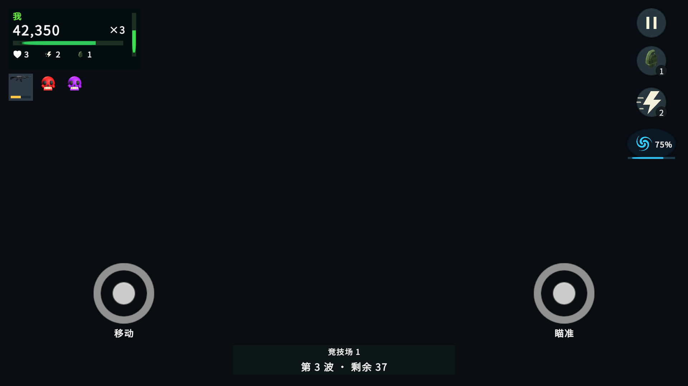

# FirepowerLoop 手机横屏 HUD 确认布局

确认日期：2026-10-19。已接入正式 HUD Prefab 和控制器，手机与 PC 按输入模式切换展示。Editor 定向测试 70 例通过；真机操作验收尚未进行。

## 已接入的实际界面

以下为当前工程真实 Prefab 使用示例快照的 Editor 渲染，背景留空以便检查 HUD；不是对局截图。

[宽屏双人及安全区](../Plans/Artifacts/MobileHud-20261019/Implemented/phone-coop.png) · [平板双人](../Plans/Artifacts/MobileHud-20261019/Implemented/tablet-coop.png) · [英文手机](../Plans/Artifacts/MobileHud-20261019/Implemented/phone-en.png) · [PC 对照](../Plans/Artifacts/MobileHud-20261019/Implemented/pc.png)

- 手机左上显示姓名、大分数、细血条、生命／冲刺／炸弹数；倍率数字及竖向进度条放在信息区右侧。双人按行排列。
- 临时武器及红／紫骷髅等效果在玩家信息下方排版；沿用现有效果、倒计时进度和骷髅末三秒轻闪规则。
- 暂停、炸弹、冲刺从右上向下排列，已获得的风暴位于冲刺下方；风暴使用独立青色旋风图标，冲刺使用闪电。风暴按钮显示充能百分比或生效剩余秒数，未获得时隐藏。
- PC 已于 2026-10-20 按独立方案更新：左上分数、血条、生命／炸弹／冲刺库存及竖向倍率，取消黄金余额；波次在顶部中央，右上仅显示已获得的能力。切换模式不改变分数、倍率或技能库存。[PC 确认概念图](../Plans/Artifacts/PcHud-20261020/confirmed-concept.png)与[正式 Prefab 预览](../Plans/Artifacts/PcHud-20261020/Implemented/pc-acquired.png)须区分，前者的场景为概念绘制，后者留空背景检查真实 HUD。
- 仅迁移风暴旧默认坐标，保留已经自定义的按钮位置。触屏编辑页与实战使用相同按钮尺寸及避让计算。

正式引用通过 `UICodeSpawner`／`BoxUICodeSpawner` 生成和回填，列表继续由 `CustomListView` 维护。

## 原确认示意

## 已确认的排布

| 区域 | 排布 |
| --- | --- |
| 右上 | 暂停入口位于最上方，与战斗技能留出间隔 |
| 右侧技能 | 从右上向下单列排列：炸弹、冲刺、已获得的能力 |
| 技能状态 | 炸弹和冲刺按钮显示剩余次数；新增能力获得后才显示对应按钮 |
| 左下 | 移动摇杆 |
| 右下 | 瞄准射击摇杆；与技能列保持可辨认、互不重叠的触控区域 |
| 左上 | 紧凑个人信息；临时效果位于其下方 |
| 底部中央 | 轮数及剩余敌人数 |

本次确认的关键调整是技能从右上向下排列。效果图采用 imagegen 绘制，是项目布局示意，不是原作截图或本工程运行截图；背景美术、图标造型、字体、像素尺寸及触控热区不据此视为已经定稿。

## 验证与待验收项

本次只运行四个真实 EditMode 测试类，均包含通过项：`ArcadeCompactHudTests` 25 例、`MobileControlLayoutTests` 31 例、`ArcadeMultiplierHudTests` 4 例、`SlayerMartFieldHudTests` 10 例。覆盖两端切换、双人权威数值、效果复用、安全区、布局编辑一致性、第一人称触控恢复及能力资格。未运行完整套件，未触发 Player Build。

双人信息文本和默认触控区在 1920×1080、2340×1080、1440×1080 及内缩安全区下检查通过；中英文示例渲染无文本框溢出。验证记录见[本次验证结果](../Plans/Artifacts/MobileHud-20261019/Implemented/verification.json)，复现脚本为 `Tools/Unity/ArcadeMobileHudPreview.cs`。

后续仍需在真机上核对字号、可触达范围、误触、遮挡和双摇杆同时操作，并检查倒地救援等复杂状态的操作体验。

## PC 独立布局接入（2026-10-20）

炸弹、冲刺作为常驻库存与生命次数同排，快捷键沿用 Q／Space；已获得风暴才在右上显示图标、充能百分比／剩余时间及可改绑热键。单机无常驻暂停按钮，沿用 Esc；双人断线退出保留二次确认，入口放在右下，避开能力区。桌面效果新增持续秒数和骷髅余量环，红／紫骷髅共用同一强化槽，示例只显示紫色。手机触控、护甲文字坐标及原效果显示保持原方案。

本次通过五个定向 EditMode 类共 59 项：`ArcadeCompactHudTests` 27、`ArcadeMultiplierHudTests` 4、`ArcadeScoreFlightTests` 6、`SlayerMartFieldHudTests` 10、`ArcadeUiTests` 12。已检查[开局未获得能力](../Plans/Artifacts/PcHud-20261020/Implemented/pc-opening.png)、[双人](../Plans/Artifacts/PcHud-20261020/Implemented/pc-coop.png)、[窄屏双人](../Plans/Artifacts/PcHud-20261020/Implemented/pc-coop-narrow.png)、[英文](../Plans/Artifacts/PcHud-20261020/Implemented/pc-en.png)和[手机回归](../Plans/Artifacts/PcHud-20261020/Implemented/phone-regression.png)，均为实际 Prefab 的示例快照渲染，无文本溢出。未运行实际对局鼠标／键盘手动验收或真实双客户端，也未触发打包。制作与预览脚本分别为 `Tools/Unity/ArcadeDesktopHudAuthoring.cs`、`Tools/Unity/ArcadeDesktopHudPreview.cs`。

原作证据和当前实现区别见[四代战斗 HUD 内容位置与样式](../参考游戏/DeadOpsArcade四代战斗HUD内容位置与样式.md)。
