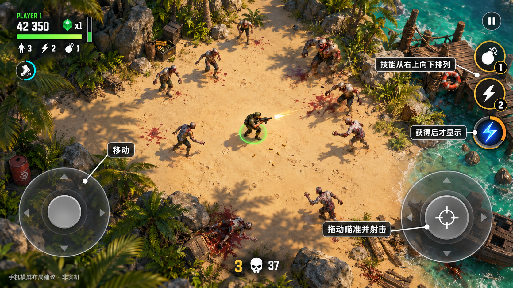

# FirepowerLoop 手机横屏 HUD 确认布局

确认日期：2026-10-19。用户已确认以下手机横屏布局，作为后续界面细化的基准。状态为布局确认；正式 Prefab 接入与真机验收另行记录。

## 已确认的排布

| 区域 | 排布 |
| --- | --- |
| 右上 | 暂停入口位于最上方，与战斗技能留出间隔 |
| 右侧技能 | 从右上向下单列排列：炸弹、冲刺、已获得的能力 |
| 技能状态 | 炸弹和冲刺按钮显示剩余次数；新增能力获得后才显示对应按钮 |
| 左下 | 移动摇杆 |
| 右下 | 瞄准射击摇杆；与技能列保持可辨认、互不重叠的触控区域 |
| 左上 | 个人信息区域；临时效果位于其附近 |
| 底部中央 | 轮数及剩余敌人数 |

本次确认的关键调整是技能从右上向下排列。效果图采用 imagegen 绘制，是项目布局示意，不是原作截图或本工程运行截图；背景美术、图标造型、字体、像素尺寸及触控热区不据此视为已经定稿。

## 后续细化范围

- 使用当前工程真实 HUD 内容逐项排版，按安全区和 Canvas 缩放确定实际边距。
- 保留现有触屏布局自定义能力，并核对右侧技能与摇杆的可触达范围。
- 分别补双人状态、倒地救援、第一人称和能力数量变化的布局。
- 在手机上核对字号、按钮尺寸、误触、遮挡与双摇杆同时操作。

原作证据和当前实现区别见[四代战斗 HUD 内容位置与样式](../参考游戏/DeadOpsArcade四代战斗HUD内容位置与样式.md)。
